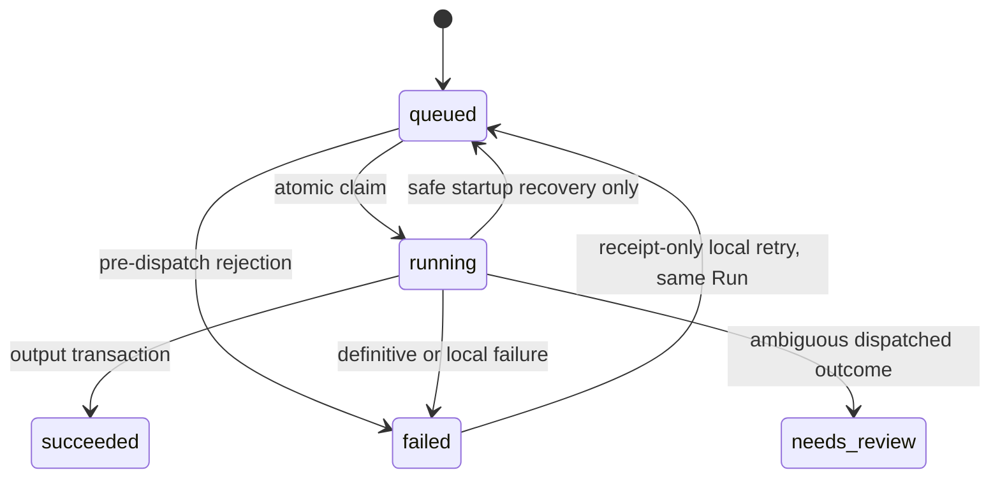

# AI Scene Composer: Standalone PoC Implementation Plan

- **Version:** 2.1, independent-review clarifications incorporated
- **Prepared:** 21 October 2026
- **Document and code language:** English
- **Target:** A local, single-user Next.js application, implemented incrementally by a coding agent
- **Verification status:** Public provider documentation and capability records reviewed. No paid requests were executed while preparing this plan. Live access, output behavior and billing remain explicit acceptance gates.

This document is self-contained and supersedes `AI_SCENE_COMPOSER_POC_PLAN_base.md` for implementation. Implement the fixed decisions below, not the alternatives or illustrative assumptions in the base document.

**Execution entry point:** Follow the [ordered delivery phases](#15-ordered-delivery-phases), starting at Phase 0. Sections 1-13 define requirements/contracts, section 14 defines tests, section 16 defines setup, and section 17 defines completion; they are not an alternative implementation order.

## 1. Goal, Scope and Non-Negotiable Rules

Build a small application demonstrating this workflow:

```text
Upload a photograph / choose a bundled sample / generate a scene with AI
    -> canonical scene and immutable root version
    -> click an object and obtain a SAM 3.1 selection
    -> inspect the mask and choose edit padding
    -> write an instruction and optionally add 0-2 reference photographs
    -> edit with Flare, Sunburst, or compare both on identical frozen input
    -> preserve protected pixels with deterministic local compositing
    -> inspect raw/final results, latency, cost and immutable version branches
```

AI scene generation is a required entry path, not a later extension. It offers **exactly three predefined prompts and a custom-prompt option**. It generates the initial scene, not reference photographs or masks. Object-aware editing remains the main experiment.

### 1.1 Fixed MVP Decisions

| Concern | Required decision |
|---|---|
| Scene acquisition | Upload, one bundled sample (explicit synthetic fallback when photographs are absent), or AI generation from a preset/custom prompt |
| Initial scene generation | Flare only; one image per explicit request; no source, mask or references |
| Edit models | `openai/gpt-image-2.5-flare` and `openai/gpt-image-2.5-sunburst` |
| Image provider | OpenRouter dedicated `POST /api/v1/images` only |
| Segmentation | Hosted Meta Model API, model `sam-3.1`; separate credentials and billing |
| Canonical scene | Opaque, sRGB, 8-bit RGB, 1024 x 1024 PNG |
| Selection | One to eight positive points and zero to eight negative points (Shift adds positive, Alt/Option adds negative) |
| Mask padding | 16 px by default, or 32 px; changing it does not call SAM again |
| Feathering | Fixed 8 px, entirely inside the allowed edit region |
| Edit references | Zero, one or two uploaded photographs, in an explicit stable order |
| Persistence | SQLite with Drizzle; immutable assets and versions |
| Execution | One local Node worker, concurrency one; API routes only enqueue paid work |
| Progress | Browser polling every 1500 ms; no browser SSE or WebSocket infrastructure |
| Budget | Default USD 5 per project; atomic reservations for all paid operations |
| Default mode | Mock providers, no credentials and zero API spend |
| Hosting | Loopback-only local Node processes; not a public/serverless deployment |

### 1.2 Invariants

1. Every version points to a canonical scene. References are not editing bases.
2. A project has at most one root. Uploading or generating another initial scene requires a new project; it never replaces an existing root.
3. Versions and asset bytes are never modified after creation. An edit creates a child of its frozen parent.
4. A comparison starts two sibling edit jobs. Model B never consumes model A's output.
5. A selection belongs to exactly one source version. It cannot be reused on another version, even if the UI currently displays that version.
6. OpenRouter receives the source scene and optional references, **not a native mask parameter**. The SAM mask controls local guidance and compositing only.
7. Decoded final RGB pixels outside the allowed edit region must equal the parent scene's RGB pixels exactly. PNG file bytes need not be identical.
8. Every provider attempt is accounted for, including failed and ambiguous attempts. Unknown charges are never silently treated as zero.
9. Network retries, browser refreshes and double-clicks must not silently create additional paid attempts.
10. Provider keys, absolute storage paths and image base64 payloads never reach browser configuration or application logs.
11. Mock or prerecorded results are visibly labeled and never satisfy live-provider acceptance criteria.

### 1.3 Non-Goals

Do not implement authentication, collaboration, video, 3D, automatic scene understanding, object catalogs, brush/polygon tools, payments, model judging, prompt rewriting, RAG, agent orchestration, Redis, queues as a service, external databases, production deployment, cancellation of running jobs, native remote masked editing, crop-based editing or automatic harmonization.

Do not add a third image model/provider, a generation-model selector, multiple generated candidates per call, visual-guide references, configurable image sizes, JPEG thumbnail pipelines or a generic provider-plugin framework. The local 1024-pixel assets are sufficient for MVP display.

## 2. Technology and Repository Layout

The repository currently contains planning files, not an application. Initialize the application in the existing repository root without deleting or overwriting planning/configuration files. Do not invoke a scaffold command that assumes an empty directory.

| Layer | Choice |
|---|---|
| Runtime | Node.js 24 LTS; `.nvmrc` contains `24`; npm and committed `package-lock.json` |
| Web | Next.js 16 App Router, React 19, TypeScript with strict checking |
| Styling | Tailwind CSS 4; functional neutral UI |
| Canvas | HTML image plus Canvas 2D/SVG overlays; no canvas framework |
| Validation | Zod; shared domain schemas separate from server modules |
| Database | `better-sqlite3`, `drizzle-orm`, `drizzle-kit` |
| Images | `sharp` for decoding, orientation, normalization and PNG encoding; typed arrays for specified mask/composite arithmetic |
| SAM client | `openai` SDK configured with Meta's base URL, plus `@meta-sam/parser` >= 0.1.0 |
| OpenRouter client | Built-in server-side `fetch`; one small image adapter |
| Worker | `tsx`; `proper-lockfile` to enforce a single worker process |
| Tests | Vitest and Playwright |
| Environment loading | `@next/env` for worker and CLI entry points, matching Next.js `.env.local` loading |

Resolve compatible package versions during Phase 1 and commit the lockfile. Do not upgrade dependencies opportunistically in later phases. The OpenAI SDK is used only as a Meta Responses transport; it must never call the direct OpenAI Images API.

```text
src/
  app/
    page.tsx
    api/
      health/route.ts
      projects/route.ts
      projects/[id]/route.ts
      projects/[id]/sample/route.ts
      projects/[id]/active-version/route.ts
      projects/[id]/costs/route.ts
      assets/route.ts
      assets/[id]/route.ts
      generations/route.ts
      segmentations/route.ts
      edits/route.ts
      comparisons/route.ts
      comparisons/[id]/route.ts
      runs/[id]/route.ts
      runs/[id]/retry/route.ts
      runs/[id]/evaluation/route.ts
  components/
    sources/SceneSourcePicker.tsx
    sources/GenerationForm.tsx
    editor/SceneCanvas.tsx
    editor/MaskOverlay.tsx
    editor/EditPanel.tsx
    editor/ReferencePicker.tsx
    compare/ComparisonPanel.tsx
    history/VersionTree.tsx
    costs/CostSummary.tsx
  config/
    scene-presets.ts
    provider-capabilities.json
    pricing.json
  lib/
    contracts/       # Zod request, snapshot, result and evaluation schemas
    db/              # Schema, connection, transactions and queries
    assets/          # Validation, normalization and private asset storage
    images/          # Coordinates, full-frame masks, regions, compositing, metrics
    providers/
      sam31.ts
      openrouter-images.ts
      mocks.ts
      types.ts
    jobs/            # Enqueue, idempotency, budgets, claim and recovery
  worker/
    index.ts
    handlers/
      generate.ts
      segment.ts
      edit.ts
  test/
    fixtures/
      manifest.json # Selected sample/reference, provenance and hashes
      photos/       # Owner-supplied redistributable photographs, when available
      synthetic/    # Deterministic locally generated offline fixtures
      licenses/     # Attribution/permission records for supplied photographs
      sam/          # Source-bound redacted captures; not fabricated masks
    unit/
    integration/
    e2e/
scripts/
  prepare-fixtures.ts
  migrate.ts
  reset-local-data.ts
  smoke-live.ts
drizzle/             # Committed SQL migrations
data/                # Gitignored database and worker lock
assets-local/        # Gitignored immutable private images
```

All API routes needing filesystem/database access use the Node.js runtime, not Edge. Configure `better-sqlite3` as a server external package. Do not import DB/provider/environment modules from client components. Shared worker modules must also run in ordinary Node, outside Next.js.

Enable SQLite foreign keys, WAL and a 5000 ms busy timeout on every connection. Open connections lazily and reuse the web connection during development reloads. Migrations are explicit, never triggered by module import or `next build`.

## 3. Initial Scene Acquisition

### 3.1 Project Initialization

`POST /api/projects` creates an empty project with `rootVersionId = null` and `activeVersionId = null`. The UI retains its ID in `/?project=<uuid>`. Existing projects remain on disk; the UI only edits one at a time.

All three source paths produce the same root-version contract:

| Path | Processing | Root provenance |
|---|---|---|
| Upload | Save untouched original, normalize to canonical scene, create root |
| Bundled sample | Import the manifest-selected local sample through the same service; preserve its licensed-photo or synthetic provenance |
| AI generation | Queue a paid generation, save raw output, normalize, create root after success |

Set both project pointers to the root in the same transaction that creates the root Version. A generated root records its originating Run. Uploaded/sample roots have no provider run and incur no provider cost.

Do not create a dummy root while generation is queued. While an initial generation is queued/running, reject another source-initialization request for that project. On failure the project remains empty and the form retains its input. Failed attempts and their costs remain visible.

The root assignment must additionally be checked in the completion transaction. A late or conflicting result must never replace a root; retain its raw asset/cost and report `ROOT_ALREADY_EXISTS` instead.

After initialization, scene-acquisition controls become **New Scene**, which creates another empty project. They must not upload a new base into the existing history. Reference uploading remains available.

### 3.2 Exactly Three Presets

Put the following registry in `src/config/scene-presets.ts`. IDs and prompt text are part of versioned input data. Set `SCENE_PRESET_VERSION = "v1"`. Display these three cards and one separate Custom Prompt option; do not generate the presets dynamically.

| ID | UI label |
|---|---|
| `cozy-living-room` | Cozy Living Room |
| `scandinavian-dining-room` | Scandinavian Dining Room |
| `minimalist-bedroom` | Minimalist Bedroom |

**`cozy-living-room`:**

```text
Photorealistic interior photograph of a cozy modern living room. A large beige fabric sofa is centered against the back wall, a separate wooden armchair is on the left, a black floor lamp is on the right, one framed picture hangs above the sofa, and a low wooden coffee table stands in the foreground. Soft daylight enters from a side window. The furniture is clearly separated and fully visible. Eye-level camera, realistic perspective and materials, square composition, no people, no text, no logos.
```

**`scandinavian-dining-room`:**

```text
Photorealistic interior photograph of a bright Scandinavian dining room. A light oak dining table with four separate chairs occupies the center, a simple pendant lamp hangs above it, a white sideboard stands against the back wall, and a potted plant is near a large window. Soft natural daylight, clearly separated furniture, realistic perspective and materials. Eye-level camera, square composition, no people, no text, no logos.
```

**`minimalist-bedroom`:**

```text
Photorealistic interior photograph of a calm minimalist bedroom. A light gray upholstered bed is centered against the back wall, two separate wooden nightstands with bedside lamps flank the bed, one framed picture hangs above it, and a freestanding armchair is on the left near a window. Soft morning daylight, clearly separated furniture, realistic perspective and materials. Eye-level camera, square composition, no people, no text, no logos.
```

Preset prompts are read-only previews. To use different wording, the user selects Custom Prompt. Custom text is trimmed, must contain 1-2000 characters after trimming, and is sent without an LLM rewrite or an undisclosed suffix. Apply the same 2000-character limit to edit instructions; target-object labels have a 1-80-character limit.

### 3.3 Generation Request and Result

Use a strict discriminated Zod union for the input:

```ts
type GenerationInput =
  | { mode: "preset"; presetId: "cozy-living-room" | "scandinavian-dining-room" | "minimalist-bedroom" }
  | { mode: "custom"; prompt: string };
```

Reject a preset request containing a custom prompt, a custom request containing a preset ID, unknown IDs and unknown fields. The server resolves preset text; it must not trust a prompt sent alongside a preset ID.

The generation snapshot stores input mode, preset ID/version if applicable, exact resolved prompt, prompt hash, model ID, transport options and pricing/capability versions. A retry reuses that stored text even if the registry later changes.

The model is always Flare. Omit `input_references` entirely. Do not require an upload, source version, selection, reference or SAM credential for image generation itself. On success, display the generated root in the same editor used for uploads; live segmentation must work on generated scenes as well as uploaded scenes.

There is no automatic reroll. Once the root exists, another generation is a new project and a new explicitly confirmed paid operation.

### 3.4 Sample and Reference Acquisition

The project owner supplies redistributable photographs; the coding agent must not invent licensing evidence, download arbitrary search results or spend on AI generation to create test inputs. Use these fixed slots:

| Fixture | Optional owner-supplied photograph | Offline fallback |
|---|---|---|
| `living-room-v1` | `src/test/fixtures/photos/living-room-v1.jpg` or `.png`; square, at least 1024 px, with sofa, chair, lamp and framed picture | `src/test/fixtures/synthetic/living-room-v1.png` |
| `reference-sofa-v1` | `src/test/fixtures/photos/reference-sofa-v1.jpg` or `.png`; a clearly visible sofa, at least 1024 px on its longest side | `src/test/fixtures/synthetic/reference-sofa-v1.png` |

Apply the same byte/pixel/format validation as other uploads. Each supplied photograph needs a matching `src/test/fixtures/licenses/<fixture-id>.md` recording creator, source URL or owner permission record, license identifier and terms/permission, acquisition date, required attribution and modifications. If a photo exists without this evidence, report `FIXTURE_LICENSE_MISSING`; do not silently include or represent it as licensed. If both extensions exist for one slot, report `FIXTURE_AMBIGUOUS` instead of choosing arbitrarily.

Implement `scripts/prepare-fixtures.ts` and `npm run fixtures:prepare` as an offline, idempotent preparation/validation step. Always prepare/verify both synthetic files with Sharp from project-authored SVG primitives: a 1024 x 1024 room with separated furniture, and a 1024 x 1024 sofa reference. Select them as fallbacks when photograph slots are absent, and keep them available for deterministic mocks even when photos are supplied. Use fixed colors/geometry, no randomness, external fonts, remote images or provider calls. Include the generator and small generated PNGs in the implementation deliverable.

Write `src/test/fixtures/manifest.json` with `schemaVersion`, fixture IDs, selected relative paths, `provenance` (`licensed_photo|synthetic`), original SHA-256, normalized SHA-256, `normalizationVersion` and nullable `licenseRecord`. Compute hashes through the actual normalization implementation. A synthetic entry records its generator/version and `licenseRecord: null`; do not assign a fictional third-party license or call it a photograph. Preparation must not overwrite owner-supplied photos or permission records.

Prefer a valid supplied photograph; otherwise select the generated fallback. The sample picker and sample root metadata show **Synthetic Sample** whenever that fallback is used. Preserve the source description in a validated nullable `Version.sourceMetadataJson` on sample roots, including fixture ID, provenance and manifest hashes. This is descriptive provenance, not a new version origin.

Phase 1 and the offline bundled-sample gate may pass using this labeled synthetic source. The separate licensed-photograph/live-evaluation gate remains `not_run` until both photographs and permission records are supplied; a placeholder does not satisfy it. README explains the two input slots, preparation command, selected provenance and missing photo gate. No owner response is required to build the mock demo.

### 3.5 Source-Bound SAM Fixture Acquisition

Freeze the selected sample bytes, normalization version, canonical PNG hash and explicit positive/negative points before recording any SAM fixture. The project owner or an explicitly authorized implementer may capture live SAM output through the metered application after the photograph is available. Capture is a paid operation, not part of `fixtures:prepare` or an automatic setup step.

Place captures in `src/test/fixtures/sam/living-room-v1.positive.json` and `.negative.json`. Their validated schema contains `schemaVersion`, `sourceKind: "captured-live"`, `sourceCanonicalSha256`, width/height=1024, normalization version, exact point arrays, model, capture date, nullable request ID and completed parser box/mask records. Retain bounds/encoding/payload needed for reconstruction; remove credentials, auth headers, input-image data URLs and unrelated response bodies. Only nonpersonal, redistributable source evidence may be committed.

Provider-documented example records are parser unit fixtures, labeled `documented-example`; they are not a capture for this sample. If no matching authentic capture exists, `SAM_MODE=fixture` returns `PROVIDER_UNAVAILABLE` before creating a Run/charge. Do not fabricate a SAM capture or substitute a synthetic mask in fixture mode. `AI_MODE=mock` remains fully usable through its separately labeled synthetic adapter.

Replaying a capture records a new fixture-mode event with calculated cost zero and no new provider request ID. Keep the capture's original request ID/bill/timing only as private provenance; do not charge it again or present its historical latency as a new live invocation.

Replacing a sample or changing normalization invalidates old captures by hash/version; do not retarget their metadata to new pixels. Re-capture only with authorization. Live smoke tests use live SAM and do not require prerecorded captures, but they require the licensed photographs and frozen sample/point configuration before spending.

## 4. Image and Asset Contracts

### 4.1 Upload Validation

- Accept JPEG, PNG and WebP by decoded format, not filename or browser MIME alone. Reject SVG, GIF, animations, truncated or malformed images.
- Maximum file size is **10 MiB = 10,485,760 bytes**. Permit one file per multipart request; cap the entire multipart body at 10 MiB + 64 KiB for fields/headers.
- Reject excessive `Content-Length` early, but also count bytes while consuming the body before parsing form data. Missing/chunked length must not bypass the limit or cause unbounded buffering.
- Limit input decoding to 40 million pixels and 12,000 pixels per side. Apply these limits to the original before resizing.
- Validate project ownership, role and initialization state before committing assets. Ignore user filenames for storage paths.
- Preserve original bytes privately. Canonical/reference files strip EXIF and unnecessary metadata.

### 4.2 Normalization

Use one versioned implementation, `normalization-v1`:

1. Apply EXIF orientation before reading effective dimensions or interpreting pixels.
2. Convert to 8-bit sRGB and flatten alpha over fixed neutral `#F0F0F0`.
3. For uploaded/sample bases, resize with `fit: contain` to 1024 x 1024, preserving aspect ratio and centering; fill all padding with `#F0F0F0`. Upscaling small valid sources is allowed.
4. For reference photographs, resize inside 1024 x 1024 with `withoutEnlargement: true`, preserve aspect ratio and **do not add square padding**.
5. Encode as opaque lossless RGB PNG. No JPEG previews are required.

Padding is visibly part of the canonical canvas, not an invisible coordinate offset. Every edit and segmentation uses canonical pixels, never the untouched original or a browser-sized preview.

### 4.3 Provider Output Policy

The checked model records expose `aspect_ratio`, not an exact-pixel `size` control. Therefore do not assume the provider returns exactly 1024 x 1024.

For both scene generation and editing:

1. Require exactly one returned image, valid PNG/JPEG/WebP raster bytes, a single frame, and a square native size with each side between 512 and 4096 pixels inclusive. Limit decoded response image bytes to 30 MiB.
2. If `media_type` is present, it must agree with the decoded image; if absent, infer the type from bytes.
3. Preserve the unmodified provider bytes as the raw asset and record native dimensions/type.
4. Normalize the square output to 1024 x 1024 with Sharp's `lanczos3` kernel; apply the same sRGB/alpha policy as above. Do not crop, letterbox or non-uniformly stretch an edit output.
5. Save this canonical normalized output separately. Use it for compositing and raw-drift metrics. If native size is already canonical, normalization still enforces color/alpha rules.
6. Reject non-square, out-of-range, animated or malformed output. Record any incurred provider cost even if validation or later processing fails.

This is an explicit resampling policy, not silent acceptance of arbitrary dimensions. The UI labels the raw view **Raw (normalized for display)** and shows native dimensions; the original raw asset remains inspectable. Phase-0/paid smoke tests must confirm that this policy works for both selected endpoints.

### 4.4 Private Storage

Store assets under `<ASSET_DIR>/<project UUID>/<asset UUID>.<validated extension>`, outside `/public`. Store relative paths, byte size, decoded dimensions, MIME type and SHA-256. Paths are constructed by the server, not accepted from API input.

Write a new uniquely named file completely before committing its Asset row. Never overwrite an existing file. A crash may leave an unreferenced temporary/orphan file; ignore it until explicit local reset. Do not add a garbage collector in MVP.

Serve only database-known assets through `/api/assets/:id`, with correct content type, `X-Content-Type-Options: nosniff` and `Cache-Control: private, max-age=3600, immutable`. Set `Cache-Control: no-store` on JSON read/status endpoints so Next/browser caching cannot freeze polling. Reject path traversal and arbitrary URLs. Local storage is not an authentication system: anyone able to reach this local server could read its assets, which is why public hosting is out of scope.

## 5. Coordinates and SAM 3.1

### 5.1 Pointer Mapping

All stored coordinates are integer canonical image pixels. Use one Pointer Events handler (`pointerup`) for mouse, pen and touch; do not also bind click/touch handlers that could bill the same interaction twice. Handle only the primary pointer/button and ignore canceled pointers. Give the image element zero border/padding and centered `object-position`, with decorative borders on an outer wrapper. From that element's `getBoundingClientRect()` compute the actual displayed image rectangle, excluding CSS letterboxing:

```ts
const scale = Math.min(rect.width / 1024, rect.height / 1024);
const displayedWidth = 1024 * scale;
const displayedHeight = 1024 * scale;
const displayedLeft = rect.left + (rect.width - displayedWidth) / 2;
const displayedTop = rect.top + (rect.height - displayedHeight) / 2;
// Reject zero-size elements and pointer positions outside this rectangle first.
const x = Math.floor((event.clientX - displayedLeft) * 1024 / displayedWidth);
const y = Math.floor((event.clientY - displayedTop) * 1024 / displayedHeight);
```

Use half-open hit bounds (`displayedLeft <= clientX < displayedLeft+displayedWidth`, likewise y); reject outside clicks before clamping accepted values to 0-1023. Do not multiply coordinates by device-pixel ratio; DPR only affects overlay rendering resolution. Test corner/center mapping, CSS resize, touch pointers and letterboxing.

A positive click replaces the previous selection and clears its negative point. Negative mode is available only after a positive point; one negative click sends both points in a **new** segmentation run. Further corrections replace the negative point rather than accumulating an unbounded list.

The server derives dimensions from the source version's asset. It validates coordinates, requires one to eight positive and zero to eight negative points, and rejects duplicate pixels or the same pixel used for both labels before calling Meta.

### 5.2 Hosted SAM Contract

Use `POST https://api.meta.ai/v1/responses`, model `sam-3.1`, authenticated with `META_MODEL_API_KEY`. Configure the OpenAI SDK with `baseURL: "https://api.meta.ai/v1"` (not the full `/responses` endpoint), a 120,000 ms timeout and `maxRetries: 0`.

Build prompts with the official helper, not hand-written token grammar:

```ts
const text = buildObjectPrompt({
  size: { width: 1024, height: 1024 },
  objects: [{
    id: 1,
    prompts: [{
      points: [
        { x: positive.x, y: positive.y },
        // Append only when the user supplied a negative point:
        // { x: negative.x, y: negative.y, label: "negative" },
      ],
    }],
  }],
});
```

Send one user message with `input_text: text` and an `input_image` data URL containing the canonical PNG. Set `stream: true` and `metadata: { mask_encoding: "one_bit" }`. Do not mix concept/noun-phrase prompts with point prompts. Do not send a previous mask as a SAM prompt.

Pass the SDK event stream to `parseImageStream(events)` once and await `finalResult`. Require a completed outcome and no error-level parsing diagnostics. Preserve the terminal response's request ID/usage through a pass-through event observer if available; do not consume the stream twice. Incomplete EOF is not successful segmentation.

### 5.3 Critical Mask Placement Contract

**SAM's decoded raster is cropped to the object's bounding box. It is not automatically a 1024 x 1024 mask.** The wire mask origin is literally `x=0,y=0`; that does not mean the object is at the scene's top-left.

1. Select the box and mask records for frame 0 and object ID `"1"`, pairing by frame/object ID, not list index.
2. Use the parser's box coordinates: `left`, `top`, `right`, `bottom`, with right/bottom **exclusive**. Require `maskRecord.bounds` to agree with the paired box. The wire's inclusive endpoints are already converted by the parser.
3. Decode `decodeMaskToRaster(maskRecord.mask)`. Validate `maskRecord.mask.width` and `.height` against `right-left` and `bottom-top`, and raster length against their product. Wire dimensions are height then width; do not transpose them. These public properties are confirmed in parser 0.1.0; import the package root, not private implementation modules.
4. Allocate a zero-filled 1024 x 1024 `Uint8Array` and paste the cropped raster at `(left, top)`. Do not resize the cropped mask to fill the canvas.
5. Reject out-of-bounds boxes, missing/duplicate object records, inconsistent crop dimensions, non-binary pixels and empty masks.
6. Require the positive pixel to be 1 and any negative pixel to be 0 in the full-frame result. Otherwise report `INVALID_SELECTION` and let the user retry explicitly.
7. Save the full-frame mask as an immutable 8-bit grayscale PNG, values 0 or 255. The application mask is binary in meaning, not a special 1-bit PNG encoding.

Include a small fixture with an off-center, non-square crop, for example a 3 x 2 mask pasted at `(4,5)` in a larger canvas. This fixture must fail if x/y are swapped, the crop is stretched, or its origin is ignored. Also test the final pixel at a box's exclusive right/bottom edges.

Do not write a custom SAM grammar/base85 parser or silently replace SAM with another model. Missing Meta access blocks live segmentation only; supported fixture mode is described in section 13.

## 6. Deterministic Edit Region and Compositing

### 6.1 Region and Blend Mask

Let `M` be the full-frame SAM mask, with values 0 or 1. Use `mask-pipeline-v1`, defined exactly as follows:

1. For padding `p` in `{16,32}`, define `E = dilateSquare(M,p)`. `E(x,y)=1` iff at least one valid source pixel within Chebyshev distance `p` is selected. Thus the structuring element is a `(2p+1)` square, not a disk.
2. Compute binary dilation with a zero-bordered summed-area table (`Uint32Array`, dimensions 1025 x 1025) over M. Query each clipped square with four table reads; set E to 1 when the sum is greater than zero. Do not assume Sharp exposes a binary morphology API, and do not approximate dilation with a blur.
3. Build a second summed-area table over E. Define `erodeSquare(E,k)` as 1 iff the clipped neighborhood sum equals its valid-pixel count. Ignore out-of-image pixels, so reaching the canvas edge does not invent an outside feather band.
4. With fixed feather width 8, compute the integer blend alpha:

```text
A(x,y) = round(255 * SUM(erodeSquare(E,k)(x,y), k=1..8) / 8)
```

5. This gives A=0 outside E and at its protected-facing boundary, ramps inward over eight pixels, and reaches 255 in the interior. Feathering never expands the allowed region.
6. Compute the half-open pixel bounding box of E and percentages `100 * coordinate / 1024`, rounded to one decimal place, for prompt guidance and inspection.

After a successful segmentation, compute and save both fixed padding variants as immutable assets: E as 0/255 grayscale PNG and A as 0-255 grayscale PNG. Store their IDs, hashes, bounding boxes and pipeline version in the Selection's validated `regionsJson`. The UI can switch padding without a paid request or duplicate browser morphology implementation.

The raw SAM mask never changes. Padding and feather configuration belong to the edit snapshot, not to mutable selection state. There is no optional visual-guide reference in this MVP.

### 6.2 RGB Composite

Decode the parent scene `S` and normalized generated image `G` into same-size 8-bit sRGB RGB arrays. For each pixel/channel:

```text
if A == 0: finalChannel = sourceChannel
else:      finalChannel = round((A * generatedChannel + (255-A) * sourceChannel) / 255)
```

Encode the resulting RGB buffer directly to lossless PNG, without a subsequent color transform or lossy encode. This byte-channel blend is deliberate; do not substitute a library's implicit alpha/color-space blend.

Store raw provider output, normalized generated output and final composite separately. A=255 must copy generated pixels exactly; A=0 must copy source pixels exactly. Protection means **all pixels where E=0**. Do not test only outside a bounding box or only on compressed file hashes.

### 6.3 Persisted Diagnostics

For protected pixels E=0, record:

```text
protectedPixelCount
rawBackgroundMae = sum(abs(Gchannel - Schannel)) / (3 * protectedPixelCount)
finalBackgroundMae = sum(abs(Fchannel - Schannel)) / (3 * protectedPixelCount)
protectedMismatchPixels = number of protected pixels with any changed channel
```

MAE is on a 0-255 channel scale. `finalBackgroundMae` and `protectedMismatchPixels` must be exactly zero; otherwise fail the run and do not create an output Version. Preserve diagnostics/raw assets for inspection.

If there are no protected pixels, both MAEs are null, mismatch count is zero, and the UI warns that no background is protected. Such a run does not demonstrate the pixel-preservation acceptance gate.

Known limitation: the model can alter the whole scene; the composite can clip new geometry, shadows and reflections or introduce seams. Exact protected pixels do not establish natural-looking editing or native masked-model behavior.

## 7. OpenRouter Image Contract

### 7.1 Verified Capabilities and Fixed Parameters

Public model pages and these endpoint records were reviewed on 21 October 2026:

- `https://openrouter.ai/api/v1/images/models/openai/gpt-image-2.5-flare/endpoints`
- `https://openrouter.ai/api/v1/images/models/openai/gpt-image-2.5-sunburst/endpoints`

Both currently advertise `aspect_ratio: "1:1"`, `quality: "medium"`, `background: "opaque"`, `n: 1` and `input_references` with a supported range of 0-16. The project only needs 0 references for generation and 1-3 total references for editing.

Neither checked record advertises `size`, `output_format` or `mask`. **Do not send these fields**, even though generic API documentation discusses some of them for other models. Do not use `/images/edits`, `/chat/completions` or the direct OpenAI image transport for this PoC.

Freeze the checked per-endpoint capability/pricing snapshots in configuration with `checkedAt`, source URLs and a version. Re-check them in Phase 0 and before opt-in live tests. If a required capability/model is missing, report `PROVIDER_UNAVAILABLE`; do not substitute a model or invent a parameter.

Pin provider routing to the advertised OpenAI provider and disable fallback. Model aliases may change upstream over time; persist the requested ID, any returned/resolved ID, capability version and request ID. Frozen inputs enable controlled comparison, not guaranteed byte-identical stochastic regeneration. Do not send an unsupported seed.

### 7.2 Exact Request Shape

Initial generation sends JSON to `https://openrouter.ai/api/v1/images` with server-side Bearer authentication:

```json
{
  "model": "openai/gpt-image-2.5-flare",
  "prompt": "<resolved preset or trimmed custom prompt>",
  "aspect_ratio": "1:1",
  "quality": "medium",
  "background": "opaque",
  "n": 1,
  "provider": { "only": ["openai"], "allow_fallbacks": false }
}
```

Editing sends the same fixed parameters, the selected model and compiled edit prompt, plus:

```json
{
  "input_references": [
    { "type": "image_url", "image_url": { "url": "data:image/png;base64,<canonical source>" } },
    { "type": "image_url", "image_url": { "url": "data:image/png;base64,<optional user reference 1>" } },
    { "type": "image_url", "image_url": { "url": "data:image/png;base64,<optional user reference 2>" } }
  ]
}
```

Construct real typed objects; placeholders above are explanatory only. Omit absent reference entries. The source is always Image 1; the first and second user references are Images 2 and 3. Source, SAM mask, E and A must never be confused with product references. Never attach a highlighted scene or mask as an extra image.

### 7.3 Deterministic Prompt Template

The edit form includes a target-object label, default `selected object`, and the user's instruction. Use this versioned template, substituting E's bounding-box percentages:

```text
Image 1 is the source scene to edit. Return one complete square scene aligned to Image 1, with the same camera, framing, geometry and lighting.
Target object: {targetLabel}.
Target bounding box in percent of Image 1: left={left}, top={top}, right={right}, bottom={bottom}.
Change the target object according to the instruction below. Preserve the rest of the scene. The bounding box is spatial guidance, not a native image mask.
User instruction:
{instruction}
{referenceLine}
```

`referenceLine` is exactly one of:

```text
No additional reference images were supplied.
Image 2 is the user-supplied appearance reference for the target object, not a replacement scene.
Images 2 and 3 are ordered user-supplied appearance references for the target object, not replacement scenes.
```

Use consistent newlines and numeric formatting. Snapshot the final string, optional target label, original instruction, source/reference hashes, pipeline versions and transport options; selection scope also snapshots mask/region hashes and padding. No LLM rewrite or automatic object captioning is allowed.

### 7.4 Adapter Boundary and Response

The shared image adapter accepts `{model, prompt, orderedInputImages, transportOptions}` and returns image bytes, observed MIME/dimensions, provider/request IDs, raw usage, observed USD cost and provider latency. `orderedInputImages` is empty for generation. The adapter knows nothing about DB IDs, version branches or compositing and has no mask parameter.

Use buffered/non-streaming responses and a 300,000 ms request timeout. Do not add fetch retry middleware. Require `data` containing exactly one valid `b64_json` image; apply section 4.3. Parse optional usage separately so a malformed optional usage field does not discard an otherwise valid image; instead record the metering problem and use the specified cost fallback.

Persist observed provider cost before/alongside local validation and compositing outcomes. A local failure after a successfully billed generation is not a free request. Do not expose raw provider error bodies to the browser without sanitization.

## 8. Persistent Data Model

Use UUIDs from `crypto.randomUUID()` for every entity/group; timestamps are UTC epoch milliseconds. Nullable fields below are actually nullable in schema/types. JSON columns are validated by the corresponding shared Zod schema, not arbitrary blobs.

```text
Project
  id PK, title, rootVersionId nullable, activeVersionId nullable,
  budgetLimitUsdMicros, createdAt

Asset
  id PK, projectId FK,
  kind (original|canonical|reference|selection_mask|allowed_mask|blend_mask|raw|final),
  relativePath, sha256, mimeType, width, height, bytes, createdAt

Version
  id PK, projectId FK, parentVersionId nullable FK, imageAssetId FK,
  origin (upload|sample|generate|edit), originalAssetId nullable FK,
  sourceMetadataJson nullable,
  originatingRunId nullable FK, createdAt

Selection
  id PK, projectId FK, sourceVersionId FK, originatingRunId FK,
  positivePointsJson, negativePointsJson, binaryMaskAssetId FK,
  regionsJson, createdAt

Run
  id PK, projectId FK, kind (generate|segment|edit), executionMode (live|mock|fixture),
  comparisonGroupId nullable, retryOfRunId nullable UNIQUE FK,
  parentVersionId nullable FK, inputSelectionId nullable FK,
  model, inputSnapshotJson, commonInputHash nullable,
  status (queued|running|succeeded|failed|needs_review), stage,
  reservedUsdMicros, budgetChargeUsdMicros,
  rawAssetId nullable FK, normalizedRawAssetId nullable FK,
  outputSelectionId nullable FK, outputVersionId nullable FK,
  providerReceiptJson nullable, metricsJson nullable, evaluationJson nullable,
  createdAt, startedAt nullable, providerStartedAt nullable,
  providerFinishedAt nullable, finishedAt nullable,
  errorCode nullable, errorMessage nullable

UsageEvent
  id PK, projectId FK, runId UNIQUE FK, operation (generate|segment|edit),
  provider, model, executionMode, outcome (pending|completed|rejected|unknown),
  amountUsdMicros nullable, costProvenance (provider|calculated|estimated|unavailable),
  pricingVersion, pricingSourceSnapshotJson, usageJson nullable,
  providerRequestId nullable, elapsedMs nullable, createdAt, settledAt nullable

IdempotencyKey
  id PK, projectId FK, key, operation, requestHash, responseStatus,
  responseJson, createdAt, UNIQUE(projectId,key)
```

Use a partial unique index for one root Version per project (`parentVersionId IS NULL`). Enforce a unique output Version/Selection per originating Run. Cross-project checks and pointer constraints run in service transactions even where a simple FK cannot express ownership.

Add indexes using these logical entity/field names: `Run(status,createdAt,id)` for claims, `Run(projectId,createdAt,id)` for rehydration, `Run(comparisonGroupId,model,createdAt,id)` for candidates/attempts, `UsageEvent(projectId,createdAt,id)` for costs, `Version(projectId,createdAt,id)` for history and `Selection(projectId,sourceVersionId,createdAt,id)` for selections. Existing PK/unique constraints cover ID lookup, idempotency and run-to-event joins; no additional indexing service is needed.

### 8.1 Kind-Specific Run Rules

| Kind | Inputs | Successful outputs |
|---|---|---|
| `generate` | No parent/selection; GenerationInput and resolved prompt snapshot | Raw/canonical asset; root Version; project pointers |
| `segment` | Parent source Version; canonical asset/hash/dimensions; points and exact SAM prompt | Selection, full mask and both region variants; no Version |
| `edit` | Parent Version, scope (selection or whole scene), optional Selection/region, ordered references and compiled prompt | Raw/canonical assets, final Version, diagnostics |

Every run, including SAM, has a model ID and a discriminated `inputSnapshotJson`. The generate snapshot includes section 3.3 fields. The segment snapshot includes source ID/hash, dimensions, point arrays and parser version. The edit snapshot includes scope, parent/source IDs and hash, normalization/prompt versions, reference IDs/hashes in order, instruction, final prompt and fixed transport options. Selection scope additionally includes selection and mask hashes, E/A IDs and hashes, padding, feather=8 and target label; whole-scene scope omits all selection fields. All include pricing/capability versions.

`commonInputHash` for comparison edits hashes only model-independent inference inputs: scope, source IDs/hashes, dimensions, ordered references, instruction/final prompt, processing/template versions and actual transport options. Selection scope also hashes selection/region IDs and hashes plus padding/feather and target label. Exclude model identity, pricing/capability record versions, consent, other accounting/discovery metadata, timestamps and run IDs. Both initial sibling runs must have the same hash and all the same model-independent inference fields.

### 8.2 History and Read Models

An uploaded/sample root points to its untouched original asset; a generated root's original asset is its raw provider output. Edited children point to final composites. Every visible editing base is canonical.

Persisting a successful edit creates a child without switching `Project.activeVersionId`. **Continue from This Result** or clicking a history node updates only that pointer. Going back to the root and editing creates another branch. Keep the graph acyclic by creating children only from existing project versions; do not expose reparent/update/delete operations.

`GET /api/projects/:id` returns project pointers, versions, selections, safe run summaries and current preflight pricing. This is the authoritative reload path, including an empty project with a pending generation. Return the complete project's lightweight history in MVP, not full provider receipts/input snapshots and not a silently truncated latest-N subset. Pagination is out of scope. `GET /api/projects` lists existing project IDs/titles in newest-first order; without a URL project, open the latest project, or show the source picker if none exists.

Manual evaluation is mutable metadata on a completed edit Run, not on Version or Asset. Its schema is `{boundaryArtifacts, promptAdherence, referenceFidelity, plausibility, notes}`: scores are integers 1-5, `referenceFidelity` may be null, and notes have at most 1000 characters. Unscored runs have null evaluation. No references means reference fidelity must be null. Higher scores mean better results, including fewer boundary artifacts.

## 9. HTTP API and Validation

All JSON request bodies are at most 32 KiB, validated with strict Zod schemas; reject unknown fields. Provider responses allow extra fields but validate every consumed field. HTTP errors use:

```json
{ "error": { "code": "INVALID_REQUEST", "message": "Human-readable explanation" } }
```

Never accept arbitrary file paths, remote image URLs, provider keys, client-supplied prices, prompts resolved for a preset, or client-supplied output dimensions.

Before length checks, hashing and snapshots, apply JavaScript `trim()` to title, targetLabel, instruction and custom prompt, retaining internal spaces/newlines and case. Omitted title defaults to `Untitled Scene`; an explicitly empty trimmed title is invalid. Do not trim/rewrite resolved preset text or user evaluation notes. The pricing manifest's `version` is the authoritative `pricingVersion`, matching `^\d{4}-\d{2}-\d{2}-v[1-9]\d*$` (for example `2026-10-21-v1`); server and UI use it verbatim.

| Endpoint | Method | Request / behavior | Success response |
|---|---|---|---|
| `/api/health` | GET | Local schema/config/modes; no paid probe | Safe capability/config status |
| `/api/projects` | GET | List existing projects | `{projects}` |
| `/api/projects` | POST | `{title?}`; title 1-120 characters, default `Untitled Scene` | 201 `{projectId}` |
| `/api/projects/:id` | GET | Rehydrate project/editor | `{project,versions,selections,runs,pricing}` |
| `/api/projects/:id/sample` | POST | `{sampleId:"living-room-v1"}`; same root import service | 201 `{rootVersionId,assetId}` |
| `/api/projects/:id/active-version` | PATCH | `{versionId}` belonging to this project | `{activeVersionId}` |
| `/api/assets` | POST multipart | `projectId`, `role=base\|reference`, one `file`; base creates root | 201 `{assetId,rootVersionId,width,height}`; rootVersionId null for references |
| `/api/assets/:id` | GET | Database-known local asset | Image bytes |
| `/api/generations` | POST | `{projectId,input:GenerationInput,costConsent}`; empty project only | 202 `{runId}` |
| `/api/segmentations` | POST | `{projectId,sourceVersionId,positivePoints,negativePoints,costConsent}` | 202 `{runId}` |
| `/api/edits` | POST | Edit body below plus one supported `model` | 202 `{runId}` |
| `/api/comparisons` | POST | Same edit body without `model`; server selects exactly Flare and Sunburst | 202 `{comparisonGroupId,runIds}` |
| `/api/comparisons/:id` | GET | Grouped candidate runs/attempts and costs | `{comparisonGroupId,runs,sharedSelectionCost,candidateCost}` |
| `/api/runs/:id` | GET | Safe summary, snapshot details, stage, outputs, error, metrics and cost | Run summary |
| `/api/runs/:id/retry` | POST | Fresh costConsent, `acknowledgePossibleDuplicateCharge`; provider retry or receipt-only local retry per section 10.3 | 202 `{runId}` |
| `/api/runs/:id/evaluation` | PATCH | Complete evaluation object; successful edit only | `{evaluation}` |
| `/api/projects/:id/costs` | GET | Amounts, provenance, holds and event list | `{totals,byOperation,byModel,events}` |

`assetId` returned by a base upload is the canonical asset, not the untouched original. The original is inspectable through root metadata. Multipart fields other than the specified fields are rejected.

### 9.1 Generation Examples

Both requests require an `Idempotency-Key` header. UUIDs below are illustrative; real IDs come from the API. The consent pricing version/amount comes from the project's current pricing response, not a hardcoded UI value.

```json
{
  "projectId": "11111111-1111-4111-8111-111111111111",
  "input": { "mode": "preset", "presetId": "cozy-living-room" },
  "costConsent": { "pricingVersion": "2026-10-21-v1", "reservationUsdMicros": 250000, "acknowledged": true }
}
```

```json
{
  "projectId": "11111111-1111-4111-8111-111111111111",
  "input": { "mode": "custom", "prompt": "A photorealistic sunlit study with a blue armchair and a wooden desk, no people." },
  "costConsent": { "pricingVersion": "2026-10-21-v1", "reservationUsdMicros": 250000, "acknowledged": true }
}
```

### 9.2 Segmentation and Edit Bodies

Segmentation point arrays are required; use `[]` for no negative point:

```json
{
  "projectId": "11111111-1111-4111-8111-111111111111",
  "sourceVersionId": "22222222-2222-4222-8222-222222222222",
  "positivePoints": [{ "x": 420, "y": 610 }],
  "negativePoints": [],
  "costConsent": { "pricingVersion": "2026-10-21-v1", "reservationUsdMicros": 2500, "acknowledged": true }
}
```

Single-edit body:

```json
{
  "projectId": "11111111-1111-4111-8111-111111111111",
  "parentVersionId": "22222222-2222-4222-8222-222222222222",
  "selectionId": "33333333-3333-4333-8333-333333333333",
  "paddingPx": 16,
  "targetLabel": "sofa",
  "instruction": "Replace the sofa with a dark green velvet sofa matching Image 2. Preserve room geometry and lighting.",
  "referenceAssetIds": ["44444444-4444-4444-8444-444444444444"],
  "model": "openai/gpt-image-2.5-flare",
  "costConsent": { "pricingVersion": "2026-10-21-v1", "reservationUsdMicros": 250000, "acknowledged": true }
}
```

A comparison uses that body without `model`, and the consent amount is the sum of two image reservations (default 500000). The API does not accept a custom model list, quality or output size. Validate unique reference IDs, role=reference, same project, count 0-2, and selection.sourceVersionId exactly equal to parentVersionId.

### 9.3 Status and Errors

Run summaries always include `kind`, `status`, `stage`, IDs, timestamps, safe error and cost state. Segment success exposes `outputSelectionId` and its mask/region asset IDs; generate/edit success exposes `outputVersionId`, raw and normalized image IDs. Only nonexistent output fields are null, never fake URLs; failed runs may still expose their saved raw/canonical assets and observed cost for inspection. For failed/needs_review runs, include a server-derived `retryMode` (`local|provider|none`) and current retry reservation/consent version; the browser must not infer these from error text.

| HTTP status | Representative codes |
|---|---|
| 400 | `INVALID_REQUEST`, `INVALID_POINT` |
| 404 | `NOT_FOUND` for missing/wrong-project resources |
| 409 | `IDEMPOTENCY_CONFLICT`, `PROJECT_INITIALIZING`, `ROOT_ALREADY_EXISTS`, `STALE_SELECTION`, `PRICING_CHANGED`, `RETRY_EXISTS` |
| 413 | `UPLOAD_TOO_LARGE`, `REQUEST_TOO_LARGE` |
| 415 | `UNSUPPORTED_IMAGE_TYPE` |
| 422 | `INVALID_IMAGE`, `INVALID_SELECTION`, `INVALID_RUN_STATE` |
| 402 | `BUDGET_EXCEEDED` for a rejected local reservation |
| 503 | `PROVIDER_UNAVAILABLE` for disabled/unconfigured live functionality |
| 500 | `INTERNAL_ERROR` with sanitized message |

Errors after enqueue appear as Run.errorCode/errorMessage, with examples `PROVIDER_TIMEOUT`, `PROVIDER_REJECTED`, `INVALID_PROVIDER_OUTPUT`, `PROTECTED_PIXELS_CHANGED` and `INTERRUPTED`. They do not change the already returned 202 response.

Use the following deterministic validation mappings. Resolve same-key idempotency replay before mutable state checks, as in section 10.1; for a new operation, validate resource ownership before consistency checks so wrong-project IDs are not disclosed.

| Trigger | HTTP / error code |
|---|---|
| Invalid JSON/UUID, unknown field, blank/oversized trimmed text, duplicate references, reference count >2 | 400 `INVALID_REQUEST` |
| Missing resource or referenced Version/Selection/Asset belonging to another project | 404 `NOT_FOUND` |
| Base upload, sample import or generation when the project already has a root | 409 `ROOT_ALREADY_EXISTS` |
| Those source operations on an empty project with a queued/running generation | 409 `PROJECT_INITIALIZING` |
| Same-project Selection's sourceVersionId differs from parentVersionId | 409 `STALE_SELECTION` |
| Referenced same-project Asset exists but kind is not reference; unsupported upload role | 400 `INVALID_REQUEST` |
| Point count/coordinates are invalid, or positive and negative use the same pixel | 400 `INVALID_POINT` |
| Wrong key payload, stale pricing/reservation consent, existing retry child | 409 `IDEMPOTENCY_CONFLICT`, `PRICING_CHANGED`, `RETRY_EXISTS` respectively |
| New paid reservation would exceed the cap | 402 `BUDGET_EXCEEDED`; create no provider job/UsageEvent |
| Missing required key/capability, or absent/mismatched authentic SAM fixture | 503 `PROVIDER_UNAVAILABLE`; create no provider job/UsageEvent |

The root check has priority over PROJECT_INITIALIZING if inconsistent data contains both. An empty/misaligned mask returned later by SAM is a Run failure, not a new synchronous 422 response to an already accepted request. Root completion conflicts likewise fail the Run while preserving observed costs.

Bind the web server to `127.0.0.1`. Mutating browser requests must be same-origin; reject unexpected Origin/Host combinations and do not enable permissive CORS. Local scripts/tests may omit Origin. No authentication or public-deployment security claim is made.

### 9.4 Safe Read Contracts

Build allowlisted DTOs rather than serializing database rows. A Run summary includes IDs/kind/model/mode, status/stage, timestamps/latency, real output/asset IDs and dimensions, sanitized error, metrics/evaluation, cost/provenance/hold and server-derived retry mode/quote. Project/comparison responses use these summaries. Fetch `GET /api/runs/:id` only when its input-detail panel opens; add an allowlisted inference-input view containing the user's prompt/points, source/reference IDs/hashes and processing options.

Never return `providerReceiptJson`, SAM protocol records/encoded payloads, raw `usageJson`, upstream response/error bodies, headers, credentials, disk paths or transport data URLs through JSON DTOs. Browser mask overlays use the intended PNG asset endpoint. Expose usage only as validated nonnegative token-count fields and request/model IDs, not arbitrary provider JSON. The costs endpoint applies the same allowlist to event summaries.

`GET /api/health` returns `{status,modes,databaseReady,worker,providers,fixtures}`. `worker` is `{status:"ready"|"missing"|"stale",heartbeatAgeMs:number|null}`: no lock means missing, lock heartbeat age <=15000 ms means ready, older means stale. This is liveness, not proof that a specific job advanced. `providers` reports per-function availability and safe reason codes such as missing_key or fixture_missing, never key values. `fixtures` reports selected sample provenance, licensedPhotosReady and samFixtureReady. HTTP 200 means valid app configuration, migrated DB and prepared offline assets; return 503/status=not_ready if those local prerequisites fail. Missing live credentials/worker do not make the otherwise usable mock/upload app unready.

`GET /api/projects/:id/costs` returns `{totals,byOperation,byModel,events}`. Totals have `providerUsdMicros`, `calculatedUsdMicros`, `estimatedUsdMicros`, `activeReservationUsdMicros`, `unknownHoldUsdMicros`, `commitmentUsdMicros`, `budgetLimitUsdMicros`, `remainingUsdMicros` and `overrunUsdMicros`. Partition each Run exactly once: a settled nonnull amount goes to its provenance bucket; settled unavailable cost goes to unknownHold; otherwise a queued/running unsettled attempt contributes its budget charge to activeReservation. A recovered unknown attempt is settled as unavailable. Pre-provider failures contribute zero. Commitment equals the five monetary buckets' sum and the Run budget-charge sum; remaining/overrun are clamped nonnegative differences against the cap. Per-operation/model groups use the same partition without duplicating project limits. Return safe event summaries; unknown amounts stay null, not zero.

### 9.5 Supplemental Examples

Comparison creation is exactly the section 9.2 edit body minus model, with consent reservation 500000 under default live prices; it returns `{comparisonGroupId,runIds:[flareRunId,sunburstRunId]}`. Preserve this model order in the response/UI even if claim order differs. No second comparison request is needed to inspect the sibling.

Provider retry request (fresh idempotency key; quote from the run DTO):

```json
{ "costConsent": { "pricingVersion": "2026-10-21-v1", "reservationUsdMicros": 250000, "acknowledged": true }, "acknowledgePossibleDuplicateCharge": true }
```

It returns `{runId}` for the new attempt. A receipt-only local retry uses reservation zero and returns the existing runId. Example evaluation PATCH:

```json
{ "boundaryArtifacts": 4, "promptAdherence": 5, "referenceFidelity": null, "plausibility": 4, "notes": "Good result; slight seam near the lamp base." }
```

Example totals for one USD 0.0025 calculated SAM call and one queued image reservation:

```json
{ "providerUsdMicros": 0, "calculatedUsdMicros": 2500, "estimatedUsdMicros": 0, "activeReservationUsdMicros": 250000, "unknownHoldUsdMicros": 0, "commitmentUsdMicros": 252500, "budgetLimitUsdMicros": 5000000, "remainingUsdMicros": 4747500, "overrunUsdMicros": 0 }
```

Example health response for a usable mock/upload app whose worker has not started:

```json
{
  "status": "ready",
  "modes": { "ai": "mock", "sam": "fixture" },
  "databaseReady": true,
  "worker": { "status": "missing", "heartbeatAgeMs": null },
  "providers": { "images": { "available": true, "reason": null }, "segmentation": { "available": true, "reason": null } },
  "fixtures": { "sampleProvenance": "synthetic", "licensedPhotosReady": false, "samFixtureReady": false }
}
```

## 10. Idempotency, Worker and Recovery

### 10.1 Atomic Enqueue

Require `Idempotency-Key` as a UUID for asset imports, sample imports, generation, segmentation, edits, comparisons and retries. Project creation and naturally idempotent pointer/evaluation PATCH requests do not require it.

The UI creates one key per intentional submit, retaining it for network retries of that submit. A new deliberate operation gets a new key. Disable the corresponding control while its POST is unresolved.

Enqueue sequence:

1. Parse and normalize the request; compute SHA-256 over stable-key-order JSON, preserving array order. Include operation, project, relevant IDs, trimmed text, points, cost consent and other input fields. For uploads, bounded-read multipart first and compute original file SHA-256 on the server from the received untouched bytes. The client sends no hash; reject an extra hash field. Hash the normalized upload identity `{operation,projectId,role,fileSha256}`, not filename or multipart boundary.
2. Check `(projectId,key)` before mutable initialization/budget checks. If operation/hash match, return the stored response/status even if the project/job has since progressed. If they differ, return 409.
3. For a new key, validate ownership, source/selection consistency, provider mode/capabilities, pricing consent and project state.
4. In one `BEGIN IMMEDIATE` transaction, recheck state/budget, reserve funds, insert frozen Run(s), and insert the idempotency response. Comparison inserts both initial runs and both reservations atomically, or neither.
5. Return 202 promptly; do not contact a provider inside the route or SQL transaction.

Database uniqueness resolves concurrent duplicate submissions. Imported assets are written before their rows/root are committed; a duplicate import may leave an unreferenced temporary file but never another root or paid run.

The enqueue steps above describe new provider jobs. Asset/sample imports instead finish synchronously with 201, no Run and no reservation, while retaining the same idempotency/replay rules. A receipt-only local retry updates its existing Run as specified in section 10.3, without inserting another Run or applying a new-spend budget gate.

For uploads the exact order is bounded parse -> server byte hash -> request hash/idempotency lookup -> validate/decode/normalize and write immutable files outside SQL -> transactional ownership/root-state recheck, Asset/root inserts and stored 201 receipt. Do not hold a transaction during Sharp work; do not reject an identical replay just because its first import already created the root.

### 10.2 Worker Loop

The worker and Next.js resolve the same absolute database/asset paths from the repository root. Use a plain `DATABASE_PATH`, not a mixture of SQLite file URLs and filesystem paths.

Acquire an exclusive `proper-lockfile` lock on the database path before recovery/claiming (`retries: 0`, heartbeat/update 5000 ms, stale 120000 ms). A second worker exits with a clear message. After an unclean crash the lock may need up to two minutes to become stale; do not delete an active worker's lock manually.

Once locked:

1. Run startup recovery below.
2. Poll every 500 ms; claim the oldest queued run, tie-break by ID, with an atomic transaction and conditional `status='queued'` update.
3. Execute only that run; do not parallelize a comparison. Stages are `preparing`, `calling_provider`, `processing`, `persisting`, then `done` or `error`. If a complete saved receipt already exists, skip the provider branch entirely and perform local processing only.
4. After preparation, open a short dispatch transaction: require this Run still running with no providerStartedAt/receipt, recheck the new-spend budget, and either fail it before dispatch or atomically set providerStartedAt/stage=calling_provider and insert its pending UsageEvent. Commit first, then invoke the provider exactly once outside SQL. Claiming and dispatch are separate transactions; a preparation failure is still pre-provider and releases only its unused reservation.
5. As soon as a terminal provider response/billing evidence arrives, persist providerFinishedAt and UsageEvent/budget settlement even if output validation/storage fails. Then save the files/receipt needed for local completion and commit the complete receipt marker only after those artifacts exist. Never roll back an observed charge because saving its image failed. Adapter errors carry billing evidence to the worker instead of discarding it.
6. Perform deterministic local processing, save assets, and transactionally create outputs/update run status. Never expose a half-created Version.
7. Continue to the next job. On graceful shutdown, stop claiming and allow the current attempt to settle within its configured timeout; release the lock afterward. Print the exact readiness line `SCENE_WORKER_READY` only after environment/schema validation, lock acquisition and startup recovery succeed; never print keys, paths or prompts with it.

No DB transaction spans a network call, full image decode or long processing loop. No automatic provider retry, including SDK retries, 429s or 5xx errors. A received provider rejection is a failed attempt; a lost/ambiguous outcome needs review.

Define `providerReceiptJson` as a validated discriminated union. An image receipt is `{kind:"image",complete:true,rawAssetId,responseMetadata}`; responseMetadata contains observed provider/request IDs and raw usage/cost when present. A live/captured SAM receipt is `{kind:"segment",representation:"sam-records",complete:true,records,responseMetadata}`; records contain completed parser box/mask bounds, encoding and payload. A synthetic mock segment receipt is `{kind:"segment",representation:"full-mask-asset",complete:true,binaryMaskAssetId,responseMetadata}`, valid only for executionMode=mock. The mask asset is full-frame 0/255 PNG; this avoids inventing a SAM wire encoder for mocks. Save no partial stream as complete. Require all referenced files or complete records before committing the receipt marker. Usage settlement is independent and may already be committed; receipt creation must not duplicate/change it. Subsequent mask/region/composite processing can be replayed from this evidence alone. Receipts remain server-private.

### 10.3 Restart and Ambiguous Outcomes

After acquiring the single-worker lock, inspect runs left `running`:

| Persisted evidence | Recovery |
|---|---|
| `providerStartedAt` is null | Return to queued: no provider invocation was recorded |
| Complete durable provider receipt and required local assets exist | Resume local processing only, never call provider again |
| No receipt, but a settled event proves provider completion | Mark failed / LOCAL_PROCESSING_FAILED: output was lost before a reusable receipt; preserve charge and allow only a new explicit provider attempt |
| No receipt, but a settled event proves provider rejection | Mark failed / PROVIDER_REJECTED; preserve known cost or unknown-charge hold |
| Invocation recorded with neither receipt nor definitive settled outcome | Mark needs_review / INTERRUPTED; settle a still-pending event as unknown/unavailable and retain the hold; never requeue automatically |

There is an unavoidable crash window between recording invocation and actually sending/receiving it. Treat it conservatively; do not claim exactly-once execution across that boundary without provider support. Recovery must preserve any already settled charge evidence; retain the original reservation only when cost is still unavailable, not instead of a known charge.

If local processing fails with a saved receipt, keep raw assets and observed charge. A manual retry of a definitively local-only failure reuses that receipt and resets the same Run to queued local processing; no new UsageEvent or provider invocation is allowed. This retry requires consent with reservation zero, keeps the existing budget charge, clears the terminal error/timestamp, and returns the existing run ID. A malformed/unusable provider result is a provider retry, not a local retry that endlessly reprocesses invalid bytes. Retry-mode classification is a typed server rule, not a client choice.

For a provider failure or `needs_review`, Retry creates a new Run with copied frozen inference input and `retryOfRunId`, a fresh budget reservation and an explicit warning if another charge is possible. Refresh the new attempt's pricing/capability metadata from the current compatible configuration; do not price a new call with a superseded rate snapshot. Keep the original run/event unchanged. Only failed/needs_review runs without successful output are retryable. Revalidate original operation preconditions, including an empty project for generation. Permit at most one direct retry child; simultaneous retries with another key return `RETRY_EXISTS`. A retry of a retry forms a chain.

The retry body is exactly `{costConsent,acknowledgePossibleDuplicateCharge:boolean}`. Require the boolean to be true for a provider retry when the previous invocation outcome or its charge is unknown; false is permitted for a definitively settled rejection or local-only retry. Expose that requirement in the server's retry DTO. A local retry has zero additional reservation and preserves the original inference/accounting snapshot. Reject retryMode=none with `INVALID_RUN_STATE`; a client cannot request a different retry mode or modify the frozen inference input through this endpoint.

Comparison retries rerun only the failed candidate, retain the group ID and common input hash, and leave the successful sibling untouched. Show attempt history and all charges. Initial comparison creation still creates exactly two jobs; later explicit retries may add attempts.

No cancel button or cancellation status is implemented. Navigating, switching project/version or closing the browser never cancels or rewrites queued/running jobs.

### 10.4 Failure Classification and State Machine

Use these typed classes rather than guessing status/retry behavior from an HTTP status alone. Settle already observed cost using section 11.2 precedence; unknown charge retains the hold. Definitive means a complete, valid response from the selected provider, not a proxy's HTML or a broken stream.

| Failure class | Run status / code | Usage/accounting | retryMode |
|---|---|---|---|
| Missing input/state/budget rejected before dispatch | failed / applicable validation or BUDGET_EXCEEDED code | No UsageEvent; charge zero | none; start corrected input as a new operation |
| Provider configuration unavailable before dispatch | failed / PROVIDER_UNAVAILABLE | No UsageEvent; charge zero | provider after configuration repair |
| Definitive OpenRouter error/refusal, including valid 4xx/5xx envelopes | failed / PROVIDER_REJECTED | outcome=rejected; reported cost wins, otherwise documented unbilled rule permits calculated zero | provider |
| Definitive Meta error response | failed / PROVIDER_REJECTED | outcome=rejected; reported evidence or unavailable with hold; never infer free from status alone | provider; acknowledge unknown charge if applicable |
| Timeout after dispatch without definitive outcome | needs_review / PROVIDER_TIMEOUT | outcome=unknown; preserve evidence or unavailable/hold | provider, explicit risk acknowledgment |
| Connection loss, incomplete SAM stream, unidentifiable proxy response or crash after dispatch without receipt/definitive outcome | needs_review / INTERRUPTED | outcome=unknown; preserve evidence or unavailable/hold | provider, explicit risk acknowledgment |
| Definitively completed image response with unusable image/geometry/base64/count | failed / INVALID_PROVIDER_OUTPUT | outcome=completed; reported/calculated/estimated cost, not assumed free | provider, never a local replay loop |
| Completed SAM response with invalid/empty/misaligned mask | failed / INVALID_SELECTION | outcome=completed; observed cost or calculated completed-image rate | provider |
| Local storage/processing error after usable receipt | failed / LOCAL_PROCESSING_FAILED | Keep settled usage/charge unchanged | local |
| Protected-pixel assertion fails with usable receipt | failed / PROTECTED_PIXELS_CHANGED | Keep settled usage/charge unchanged | local after fixing implementation |
| Output lost in local storage before a complete reusable receipt | failed / LOCAL_PROCESSING_FAILED | Keep all observed usage/charge; do not assume free | provider, subject to new consent |

If generation cannot install its root after a late conflict, fail with ROOT_ALREADY_EXISTS, retain billed artifacts/cost and set retryMode=none. Pure parsing/preparation failures before dispatch create no event; no local retry is permitted without usable saved data. For a known upstream failure, do not translate the original provider HTTP status into a later browser HTTP response: the accepted job is polled as a Run.



The safe-recovery edge is limited to section 10.3's evidence rules. A provider retry of failed/needs_review creates a **new** queued Run linked by retryOfRunId; the original terminal Run does not transition back to queued. The diagram does not imply cancellation or automatic retry.

## 11. Cost Accounting and Budget Rules

### 11.1 Versioned Pricing Sources

Store `checkedAt`, version, currency, provider/model, source URL, units and rates in `src/config/pricing.json`. Include capability version and reservation configuration. Validate configuration at startup; never fetch rates automatically while processing a frozen job.

Public reference rates observed on 21 October 2026:

| Provider/model | Billing unit | Reference rate |
|---|---|---|
| OpenRouter Flare | Text input tokens | USD 5 / million |
| OpenRouter Flare | Image input tokens | USD 8 / million |
| OpenRouter Flare | Image output tokens | USD 30 / million |
| OpenRouter Sunburst | Same three units | Same displayed rates; not necessarily the same final image cost |
| Meta SAM 3.1 | Input images | USD 2.50 / 1000 images, or USD 0.0025 per image |

These are dated references, not guaranteed future quotes. OpenRouter and Meta are separate billing accounts. Do not use direct OpenAI prices or claim SAM is included in the OpenRouter balance.

### 11.2 UsageEvent Rules

Insert one UsageEvent before each provider invocation and settle it when evidence becomes available. Operations include **generate, segment and edit**. Jobs rejected before a provider call have no UsageEvent and zero budget charge, but remain inspectable as failed Runs. Executed mock/fixture adapters also record a zero-cost event for traceability, explicitly identifying that no live provider was invoked.

Cost precedence:

1. Valid nonnegative provider-reported USD cost: `provider`.
2. Complete authoritative usage plus the frozen applicable rates: `calculated`. For a completed SAM provider response, one input image at the verified flat rate qualifies even when local mask validation fails; a rejected/incomplete response alone does not.
3. A confirmed completed image-generation operation without sufficient billing data: use the configured image reservation as a clearly labeled `estimated` cost, with that estimate source recorded, even if its returned image later fails local validation. If completion itself cannot be established, use unavailable instead.
4. Ambiguous attempt without reliable charge evidence: amount null, `unavailable`; retain its reservation as a possible-charge hold.

When only aggregate prompt/completion token counts exist, do not assume they distinguish text input, image input and image output. Use token arithmetic only when those categories are unambiguously available:

```text
USD = textInputTokens * textRatePerMillion / 1_000_000
    + imageInputTokens * imageRatePerMillion / 1_000_000
    + imageOutputTokens * imageRatePerMillion / 1_000_000
```

OpenRouter documents completed generations as billed and definitive failed generations as unbilled. A received, valid failure response can therefore record calculated zero with that documented billing rule as source. A local timeout/lost response is not proof of that failure outcome. Do not apply OpenRouter's failure rule to Meta without evidence.

Use integer USD micro-units for reservations and aggregation (USD 1 = 1,000,000 micros); retain original provider cost/usage in the receipt for inspection. Round provider amounts to the nearest micro-unit and reservations upward. Historical events keep their pricing snapshot when config changes. Mock/fixture events have zero calculated cost and an explicit mock/fixture source, not a fabricated provider-reported charge.

### 11.3 Atomic Reservations

On project creation, snapshot `PROJECT_BUDGET_USD` into `Project.budgetLimitUsdMicros` (default 5,000,000). The UI displays it read-only. Existing projects do not silently change caps when an environment default changes.

Reserve the following for a new job:

- Image generation or single edit: `IMAGE_RESERVATION_USD`, default USD 0.25.
- Segmentation: verified per-image SAM rate, currently USD 0.0025.
- Comparison: two image reservations, default USD 0.50; the existing mask is not billed again.
- Mock execution, prerecorded SAM fixtures and receipt-only local retries: zero additional reservation.

Every Run initially sets `reservedUsdMicros` and `budgetChargeUsdMicros` to its reservation. Project budget commitment is **the sum of budgetChargeUsdMicros for all its Runs**, including queued/running jobs, settled charges and unresolved holds. This single sum prevents double-counting UsageEvents plus reservations.

On settlement, replace `budgetChargeUsdMicros` with a known provider/calculated/estimated amount, or retain the original reservation for unavailable cost. A pre-provider failure sets it to zero. Never release an unknown charge as if it were free. UI totals separately show observed/calculated spend, estimates, active reservations and unknown-charge holds.

Within the enqueue transaction for a new paid provider attempt, require current commitment + all new reservations <= project cap. For a comparison, reserve both or return `BUDGET_EXCEEDED` without creating either job. In the dispatch transaction recheck commitment: if a prior actual overrun has exceeded the cap, fail the currently claimed/preparing Run and the project's other queued paid runs that have no providerStartedAt/receipt with `BUDGET_EXCEEDED`, releasing only their unused reservations. Insert no UsageEvent for those blocked runs. Receipt-only local retries/processing and zero-cost mock/fixture adapters skip this new-spend gate and remain permitted above the cap; never release a prior charge merely because its local processing is queued again. Do not retry or undo a completed charged call.

`costConsent` must contain the current pricing version, the server-computed total reservation, and `acknowledged: true`. Reject stale/mismatched consent; never accept its amount as a client-defined price. The UI shows the estimate/reservation and remaining budget before Generate/Edit/Compare/Retry confirmation. SAM click selection shows its per-call charge beside the canvas; the intentional selection action is its confirmation.

USD 0.25 is a **local reservation estimate, not a provider-enforced per-image maximum**. Actuals can exceed it and the local project cap. Configure an account/key-level provider spending limit where available; the app cannot guarantee a hard external charge ceiling. Unknown charges may require manual dashboard investigation; there is no invoice-reconciliation UI in MVP.

### 11.4 Comparison and Project Totals

Show candidate costs separately, including retry attempts, and a combined candidate total. Show the successful Selection's originating segmentation event separately once, labeled as the mask used by both candidates. Earlier selection/correction failures and initial generation remain in project totals, not duplicated per candidate.

Provider latency is request start through received terminal provider response, excluding queue wait and local compositing. For mock/fixture execution or an unknown provider outcome it is null; show local attempt/job duration under a different label if useful. Do not mix these durations in model comparisons. Format per-run/event costs with six decimal places (for example `USD 0.002500` for SAM); null is unavailable, not `USD 0.000000`. Budget caps may use two decimal places, but detailed costs/totals retain micro-unit precision.

## 12. UI Behavior and Race Handling

Use a neutral three-column desktop layout; at widths below 1024 px use a single-column flow with the scene above edit controls. Verify at 390 px and 1440 px widths. Do not hide required actions on mobile.

- Left: source picker/current project, New Scene, small project selector and clickable version tree.
- Center: scene, positive/negative mode, mask/allowed-region overlay, before/after slider.
- Right: scope toggle (Selection / Whole scene), target label and 16/32 px padding only for Selection, edit instruction, 0-2 ordered references, single-model selector, Run Edit, Compare Both, result cards and costs.

### 12.1 Empty Project and Generation

Show Upload, Sample and Generate source tabs. Generate shows the three preset cards plus Custom Prompt. Preset selection displays exact read-only text; Custom Prompt shows a labeled textarea with character count. Disable Generate until its chosen input is valid and the cost confirmation is accepted.

Show queued/running stage, retryable failure and cost for initial generation even before any image exists. Polling and reload must recover it. A refusal/failure keeps the prompt and empty state; do not fall back to a sample or auto-run another preset.

### 12.2 Selection and Edit

1. Display the scene and full-frame SAM mask aligned to the same actual image rectangle. Default cyan overlay opacity is 0.35; expose a toggle and opacity range 0-0.8.
2. Display the allowed region for the selected padding distinctly from the raw object mask. Explain that only the allowed region may change in the final composite.
3. Disable point submission while its segmentation POST/job is pending to avoid accidental paid corrections. A subsequent deliberate negative-point request is another billed call.
4. A selection edit requires a successful Selection for the active Version, a valid instruction/target and valid references; a whole-scene edit requires only a valid instruction and references. Disable model actions otherwise and explain why.
5. Changing padding uses stored region assets and does not change Selection or request another mask.
6. Reference thumbnails are labeled Image 2/Image 3 with explicit move-left/move-right and remove controls. Submission freezes the displayed order.
7. Result cards show status, model, raw/final toggle, native/normalized dimensions, provider latency, cost/provenance and errors. One comparison failure must not hide the other success.
8. The before/after slider always uses that result's exact parent, not the current active scene. Side-by-side model comparison uses final images by default.
9. Continue from This Result selects its final Version only. Raw output is inspectable but never silently becomes an editing base.
10. Add simple 1-5 score controls and notes for completed edits; persist them through the evaluation endpoint.

### 12.3 Frozen Work and Reload

Each intentional submit snapshots current input; editing the form afterward cannot alter queued jobs. While a POST response is unresolved, duplicate clicks reuse the existing request key, not a new one.

Track the source Version and point-request fingerprint for pending selection. Apply a returned mask to the editor only if both still match the current view; persist old-version results without applying them to a new base. Switching versions clears active points/selection and the edit draft; a saved selection may be explicitly reused only on its own version.

Switching project/version does not cancel paid jobs or auto-select a later completed edit. Rehydrate current pointers, selections, runs, comparisons and costs from the server after reload; do not depend on in-memory React state or localStorage for the version graph.

### 12.4 Exact Polling and Worker Status

On opening a project, request `GET /api/projects/:id`, `GET /api/projects/:id/costs` and `GET /api/health` once. After each successful mutation, immediately rehydrate the affected project; refresh costs after job creation or an observed status/cost change. No GET request may submit/retry a paid operation.

While the selected project's latest snapshot contains a queued/running Run, request `GET /api/projects/:id` and `GET /api/health` every 1500 ms. Schedule the next request after the preceding one settles; permit at most one in-flight request per endpoint. Polling uses only lightweight project summaries, not one timer per Run. Fetch `GET /api/runs/:id` for the input-detail panel on demand, not continuously. Costs refresh when the project poll reveals changed status/accounting fields, including settlement during local processing.

Stop recurring polling after the snapshot has no queued/running jobs, on unmount or on project change. Abort old requests before a post-mutation refresh/navigation and apply responses only for the current project/request epoch, so an older GET cannot overwrite a newly selected active version. A failed GET does not clear known runs, outputs, holds or draft state.

For network/5xx polling failures, show a nonblocking connection warning and retry that GET with delays 3000, 6000, then 15000 ms maximum; reset to 1500 ms after success. Initial hydration can use the same bounded backoff until its first success; terminal 404 shows project-not-found and stops. No failed poll creates a new Idempotency-Key or resubmits a POST.

Use health.worker status from section 9.4. When missing/stale and work is queued/running, show a banner explaining that jobs persist, the worker must be started/recovered, and an unclean lock may take two minutes to expire. A stale heartbeat is not proof of provider failure: do not alter Run status, release reservations, kill processes or offer automatic paid replay from the browser. Unknown health due to a GET failure is displayed as unknown, not confidently missing.

Show textual stages, not invented provider percentage completion. Use labeled controls, keyboard-operable range inputs and readable error messages. Every visible button must work.

## 13. Mock, Fixture and Live Modes

Use these explicit modes; never switch providers automatically because a key is missing:

| Configuration | Behavior |
|---|---|
| `AI_MODE=mock` | All providers are deterministic test doubles; no network calls, even if real keys exist; zero charges |
| `AI_MODE=live`, `SAM_MODE=fixture` | Real OpenRouter; prerecorded SAM selection only for exact supported sample/hash/point fixtures; Meta key unnecessary |
| `AI_MODE=live`, `SAM_MODE=live` | Real OpenRouter and Meta; both keys/access required |

`SAM_MODE` has no effect when AI_MODE is mock. Validate required keys/configuration for enabled live functions and expose clear unavailable reasons. A missing Meta key disables live segmentation, not otherwise configured OpenRouter generation/edit adapter functions; do not fail the entire app startup solely for that missing key. Generation itself has no SAM dependency; an OpenRouter-only user can generate/upload scenes and inspect them, but cannot claim live object selection.

Prerecorded fixture mode must match canonical source SHA-256, normalization version and supported points; it must not paste an unrelated sample mask onto an uploaded, generated or edited scene. Unsupported/missing fixture requests return `PROVIDER_UNAVAILABLE` with guidance to enable live SAM or supply a capture for the frozen licensed sample. It is valid for no authentic SAM fixture to be present during offline implementation.

Show a permanent mode banner and per-run executionMode. Live-with-SAM-fixtures is a partial demonstration only, not a successful live end-to-end PoC. Do not implement local GPU SAM deployment as a hidden fallback.

### 13.1 Deterministic Mock Contracts

Mocks are pure with respect to inference input; they use no randomness, network, credentials or process-local call counter. All run through the real queue, receipt/recovery, asset, version and accounting services; zero costs are labeled mock, not provider bills.

| Adapter | Required behavior |
|---|---|
| Initial generation | Return the committed synthetic `living-room-v1.png`, normalized to 1024 x 1024, for all three presets and custom prompts. Snapshot the real chosen prompt even though this test double does not understand it. |
| Image edit | Decode Image 1 and return a complete 1024 x 1024 image: Flare replaces each red byte with `(R+40)%256`; Sunburst replaces each blue byte with `(B+40)%256`; retain other channels. Ignore reference semantics, but validate their order/count. Do not apply the local mask here: the real compositor must still prove protection. |
| SAM | Build a cropped binary box with half-open bounds `[max(0,x-64),min(1024,x+65))` and the equivalent y bounds, centered on the positive point. Fill with 1; if the negative point lies inside, clear that single pixel. Paste through the same crop-to-canvas helper and validate/save the full mask. This is synthetic geometry, never claimed as SAM inference. |

Use the full-mask-asset segment receipt variant for the synthetic adapter; do not write a SAM grammar/base85 encoder just for mocks. Retries/restarts with the same input produce the same image/mask bytes; real timings and Run UUIDs need not be deterministic. Golden tests bind to committed fixture/generator and processing versions. Fault cases use explicit injected test doubles in the test harness, not magic prompts or production HTTP bypasses.

## 14. Tests and Acceptance Evidence

### 14.1 Offline Unit Tests

All tests default to mock mode and prohibit live network requests. Credentials being present in the environment do not enable spending. Configure Vitest include patterns only for `src/test/unit/` and `src/test/integration/`; it must not collect Playwright specs or the opt-in live script.

| Area | Required cases |
|---|---|
| Presets/custom | Exactly 3 stable IDs and exact texts; server resolution; preset/custom XOR; empty/whitespace/oversized/unknown input rejected |
| Fixture preparation | Missing photos select labeled synthetic assets; supplied photo without permission fails; hashes/normalization are stable; changed source invalidates SAM capture; preparation never calls a provider |
| Image import | JPEG/PNG/WebP, EXIF rotation, alpha flatten, portrait/landscape padding, reference no-padding, oversize bytes/pixels, animation/malformed rejection |
| Coordinates | Corners/center, CSS contain offsets, outside clicks, resize/touch/DPR, integer range |
| SAM | Positive/negative grammar, completed vs truncated stream, crop dimensions and offset paste, object-ID pairing, half-open box bounds, empty/invalid mask |
| Regions | Exact square dilation at 16/32, edge clipping, inward feather=8, A range 0-255, raw mask unchanged, bbox/percent formatting |
| Composite | A=0 source copy, A=255 generated copy, exact blend rounding, protected equality, no alpha/color drift; differing native square sizes normalized deterministically |
| Provider payload | Generation has no references/source/mask; edits have source first and 0-2 refs; same fixed fields; no size/output_format/mask/unsupported seed |
| Provider output | PNG/JPEG/WebP; absent/mismatched media_type; zero/multiple images; non-square/out-of-range/invalid image; missing/malformed usage |
| Domain | Root uniqueness, cross-project rejection, parent/selection mismatch, immutable branch graph, active pointer only |
| DTO/validation | Exact section 9 mappings and trim/hash rules; no receipts, protocol payloads, paths or raw provider bodies in any JSON read model |
| Cost | Micro-unit arithmetic, provenance precedence, missing token partitions, unknown hold not zero, no segmentation double-counting, dated rates preserved |
| Idempotency | Same key/payload replays; changed input conflicts; concurrent duplicate and comparison both-or-neither reservation |

### 14.2 Integration Tests with Temporary DB and Assets

Use fresh migrated SQLite and isolated asset directories per suite; never the developer's configured data. Test service/route contracts plus the worker, not only mocked UI responses.

1. Upload -> original/canonical assets -> root -> restart/read-back.
2. Each of the three preset requests and a custom request -> queued generate -> worker -> canonical root -> generation ledger event. Run all four with mock providers.
3. Failed/ambiguous generation -> no root, preserved prompt/cost; retry without overwriting any later root.
4. Segmentation -> cropped parser mask -> full-frame Selection plus both region variants; negative correction creates another Selection without mutating the previous one.
5. Edit with 0, 1 and 2 references -> raw/canonical/final -> metrics -> child Version; optional usage failure does not lose the image or create a fake exact bill.
6. Root -> A -> B, then root -> C: A/B remain unchanged and visible after reload.
7. Comparison siblings have identical common-input hash, frozen parent/masks/prompts/reference order and separate output/cost. Simulate one success and one failure, then retry only the failed candidate.
8. Simulate provider 400/401/402/429/502, refusal, timeout, malformed base64, bad dimensions and local compositing failure after a billed response.
9. Restart queued work; restart before providerStartedAt; restart with durable receipt; restart during unknown provider outcome. Assert no implicit second provider invocation.
10. Reject a second worker, concurrent root initialization and concurrent budget oversubscription. Confirm unknown costs keep holds and actual overruns stop unstarted jobs.
11. A failed local-processing retry with durable receipt invokes no provider and creates no second UsageEvent/output.
12. Validate bounded multipart/JSON reads even without Content-Length, path traversal rejection, no key/path/base64 leakage and fixture hash restrictions.
13. Exercise every section 10.4 failure-class row, including untrusted proxy 5xx versus definitive provider rejection, lost output after an observed charge, and the currently claimed/preparing Run blocked at dispatch.

### 14.3 Playwright

Use a mock app and mock worker with dedicated test database/asset paths, `testDir: "./src/test/e2e"`, `workers: 1`, `fullyParallel: false` and retries disabled. Prepare unique test paths and run synchronous migrations during configuration-time setup, before either managed process starts; do not rely on globalSetup running before webServer initialization. Each test creates its own project. Never run against the developer's real data.

Use two `webServer` entries and `use.baseURL: "http://127.0.0.1:3100"`:

| Process | Command and readiness |
|---|---|
| Worker | `npm run worker`; no HTTP URL/port; `wait: { stdout: /^SCENE_WORKER_READY$/m }`, timeout 60000 ms |
| App | `npm run dev -- --port 3100`; `url: "http://127.0.0.1:3100/api/health"`, timeout 120000 ms, `reuseExistingServer: false` |

Pass identical explicit test env to both: AI_MODE=mock, SAM_MODE=fixture, RUN_LIVE_AI_TESTS=0, empty provider-key values and the isolated DATABASE_PATH/ASSET_DIR. No existing worker is reused; its unique DB path/lock and managed process establish isolation. Set stdout/stderr to pipe for useful diagnostics, not as a prerequisite for output matching. Select and lock a Playwright version supporting webServer.wait.stdout. Use gracefulShutdown with SIGTERM and a 5000 ms timeout for these mock processes.

Wait for the worker's stdout signal and the app health URL; before browser scenarios assert health reports the expected mock modes and ready worker. Health must not perform a paid probe. A worker entry without URL **and without wait** is insufficient readiness. Do not give the worker the app URL, which could become ready without the worker. Occupied app port or a failed worker lock is an error, never permission to reuse another developer session.

Cover upload/sample, all three generation presets, custom generation validation/success/failure, selection/correction, padding switch without another SAM call, reference ordering, single edit, two-model comparison, slider/raw/final, Continue, history branch, saved scores, project costs and full-page reload during pending generation/edit.

Include double-click submission, stale-mask result after a version switch, partial comparison failure and mobile/desktop layouts. Verify controls by accessible roles/labels. Assert external provider calls are impossible in this suite.

Test poll request counts/1500 ms cadence, backoff, no idle/per-run polling, stale response suppression, missing/stale worker banners and no POST resubmission after a polling 5xx. Fault-oriented browser cases may inject safe GET responses; integration tests separately verify the true persisted failure/retry paths.

### 14.4 Explicitly Opt-In Paid Smoke Tests

`npm run test:live` must exit before any network call unless **both** `RUN_LIVE_AI_TESTS=1` and `AI_MODE=live` are set. The complete minimum suite additionally requires `SAM_MODE=live`, access to both provider accounts, both licensed photograph slots/permission records and a frozen sample/point configuration; fail its prerequisite check before spending if any are unavailable. Prerecorded SAM captures are not required for this live test. Running live tests also requires explicit human authorization for their described cost; a coding agent must not turn on the flag merely to satisfy a stage gate.

`RUN_LIVE_AI_TESTS` gates the smoke script only, not normal UI functionality. A user can intentionally generate/select/edit through a configured live app with the ordinary cost-consent actions while that flag remains zero. A coding agent must not use those UI actions to bypass the requirement for explicit approval of its automated paid verification.

Use the same enqueue/worker/budget/ledger services as the app. Create dedicated titled smoke projects and retain artifacts. Do not call providers through an unmetered side script. Display planned call count and reservations before execution.

Minimum live smoke scenarios:

1. Flare generation with `cozy-living-room`, no source/references/mask; canonical root and generation charge persisted.
2. Flare generation with an explicitly supplied custom prompt in another empty project; verify exact text/provenance and root behavior.
3. SAM positive-only selection, then positive+negative correction on the licensed sample; verify crop-to-canvas placement and complete stream.
4. Queue one standalone Flare edit without user references. Then queue **one comparison** with one user reference, creating its Flare and Sunburst sibling runs together; inspect the Flare candidate's reference order, normalization and protected pixels.
5. Inspect the Sunburst candidate already created by that same comparison, with exactly the same frozen parent/selection/padding/prompt/reference as Flare. Do not enqueue another Sunburst call or repeat the comparison just to inspect this candidate.

These require five image calls and two SAM calls before any optional retries/additional examples. If prerequisites or budget approval are missing, record the unfulfilled gates; do not fabricate fixture evidence as live success. The three preset mappings are exhaustively covered offline; paying for all three is optional, not an implicit smoke-test expansion. This minimum suite does not by itself prove generated-scene SAM selection or further branch edits; those separate live-checklist gates require their own explicitly approved calls.

### 14.5 Controlled Evaluation

Provide five fixed manual cases: recolor sofa, replace lamp from a reference, remove wall picture, change object material, change chair. Store case definitions in test fixtures; keep a README evidence table with `not_run`, `passed` or `failed`, run IDs and observations.

For each executed case, use the same source, Selection, region, references, prompt and transport parameters for both models. Record latency, cost/provenance, normalized-raw MAE, final protected MAE/mismatch count, and manual 1-5 scores. Do not publish an aggregate model-intelligence ranking. Additional live cases/repetitions require separate budget approval.

## 15. Ordered Delivery Phases

Implement in order. Each phase must compile and leave the previous phase working. Required shared infrastructure is implemented early; do not postpone root/version/idempotency/budget schema until after paid features.

### Phase 0: Read-Only Provider and Contract Check

1. Re-read public OpenRouter guide/model/endpoint records and Meta SAM/parser docs. Verify exact model IDs, provider pin, reference capacity, supported parameters, cropped-mask geometry and package exports/version.
2. Write versioned capability/pricing configuration and redacted documented response fixtures. Mark documented examples separately from any later real captured responses.
3. Record required account access: OpenRouter for both image operations; Meta separately for live segmentation. Do not inspect/print secret values or make a paid probe.
4. Freeze the contracts in this plan. No native mask, exact-size field, output-format field, prompt rewriter or provider fallback.

**Gate:** Required public capabilities are present, or a precise blocker is recorded. This gate verifies documentation, not live access. Offline implementation may proceed with labeled mocks; missing capabilities must not be silently worked around. Minimal package/config bootstrap needed to commit these files is permitted.

### Phase 1: Local Foundation and Offline Execution

1. Initialize Node/Next/React/TypeScript/Tailwind, scripts, env loading and lockfile in the existing root.
2. Add schema, migrations, DB connection, private asset store and bounded image normalization.
3. Implement project creation/read-back, base/reference upload, sample import and atomic root creation. Add section 3.4's preparation script, manifest and deterministic synthetic sample/reference; use owner-supplied photographs only with their required provenance/permission records. Missing photo slots are a visible deferred photo gate, not a blocker to the mock demo.
4. Implement shared idempotency, integer budget reservations, UsageEvent recording, worker lock/claim/recovery and mock adapters. Provide a testable worker run-once function; production worker loops around it.
5. Render source and minimal version tree. Add health/config endpoint and explicit mode banner.

**Files:** DB/assets/jobs/contracts modules, worker entry, import/project routes, migrations, sample fixtures and scripts.

**Verify:** Unit/integration tests, typecheck and lint.

**Gate:** Upload/sample (including labeled synthetic fallback) survives restart, one root exists, coordinates map correctly, duplicate import is safe, worker lock/claim/recovery passes offline tests, no provider credentials required. Record photograph readiness separately; do not mark it satisfied by a synthetic source. Complete domain handlers arrive in their feature phases; do not invent succeeded runs without their required outputs to satisfy this foundation gate.

### Phase 2: Preset and Custom AI Scene Creation

1. Add the exact three preset constants, strict GenerationInput schema and source-picker/generation form.
2. Implement generation route/handler using the shared image adapter, budgeting, consent and idempotency.
3. Implement raw validation/normalization, durable receipt, root creation, prompt provenance, polling, failure/retry and reload of an empty/pending project.
4. Implement OpenRouter payload construction/response parsing behind tests. Live functionality requires configured credentials and normal UI cost consent; automated paid verification separately requires explicit approval. Mocks exercise the full service flow without either provider account.

**Verify:** All three presets plus custom path through integration and Playwright mocks; no input references/mask; duplicate generation causes one attempt.

**Gate:** User can create an editing base from upload, sample, any preset or a custom prompt; generated roots/costs are persisted and an existing root cannot be overwritten.

### Phase 3: SAM Selection and Exact Masks

1. Implement Meta adapter with the official helper/parser and complete-stream checks.
2. Implement crop-to-canvas paste, binary mask validation, both padding/alpha variants and immutable Selection persistence.
3. Add positive/negative UI modes, region/opacity previews, padding controls, stale-result guards and source-bound fixture validation. Authentic captures may remain absent until the licensed source is frozen and capture is authorized; mock selection still works.
4. Test off-center non-square crops, mask edge cases and exact morphology/feather formula before using these masks for paid edits.

**Verify:** Unit, integration and browser selection tests. A human-authorized SAM-only manual check can run through the UI now if access exists; the complete smoke script runs after comparison is implemented.

**Gate:** Selected object aligns at all display sizes; padding does not call SAM; unsupported fixture inputs cannot receive an unrelated mask. Live SAM remains a separate gate if unavailable.

### Phase 4: Single-Model Editing and Branches

1. Implement edit DTO validation, frozen prompt/input snapshot and source-first reference construction; Flare is the first UI default.
2. Add reference uploads/order, provider output validation, exact RGB composite and persisted diagnostics.
3. Save raw/canonical/final assets and child Versions transactionally. Add result raw/final view, exact-parent slider and Continue action.
4. Enable history-node selection and branching using the version schema already present; never mutate prior images/rows.
5. Add local-only receipt reuse and explicit provider retry states.

**Verify:** 0/1/2 references, normalization, protected equality, billed local failure, restart/retry and root -> A -> B plus root -> C tests.

**Gate:** An edit creates an inspectable immutable child and a branch without changing any protected pixel. Human-authorized Flare smoke must verify actual output behavior before live integration is claimed.

### Phase 5: Comparison, Metering and Evaluation

1. Expose Sunburst through the same adapter and single-edit model selector.
2. Implement one-transaction comparison enqueue with frozen shared inputs, two reservations and two sibling initial jobs.
3. Add side-by-side results, partial-failure handling, single-candidate retry, cost provenance/holds, project totals and scores.
4. Add the five-case evaluation definitions/table and request/configuration inspection UI.

**Verify:** Common-input hash, no source chaining, atomic budget failure, shared mask cost counted once, retry attempt history and reload.

**Gate:** One comparison is fully usable offline. A paid comparison using both models on identical frozen reference-driven input is required for full live completion.

### Phase 6: Hardening, Live Evidence and Setup Documentation

1. Complete the test matrix, mobile/accessibility checks and secret/path-leak checks.
2. Run lint, typecheck, offline tests, build and browser tests; fix regressions before reporting completion.
3. Run the explicitly approved minimum live suite if keys/access/budget approval are available. Preserve exact observed failures and costs, not just successful screenshots.
4. Write README setup, scripts, modes, provider prerequisites/privacy, architecture constraints, normalization/mask rules, cost semantics, demo steps, licensing and guarded reset instructions.
5. Check a fresh setup using committed migrations and the lockfile; no hidden manual SQL or global dependencies.

**Gate:** A fresh local checkout runs the entire mock demo without keys. Full live Definition of Done is either evidenced or explicitly listed as blocked/partial, never inferred from mocks.

## 16. Environment, Scripts and Running

### 16.1 Environment

Create `.env.example` during implementation, with no real secrets:

```dotenv
AI_MODE=mock
SAM_MODE=fixture
OPENROUTER_API_KEY=
META_MODEL_API_KEY=
DATABASE_PATH=./data/scene-composer.sqlite
ASSET_DIR=./assets-local
PROJECT_BUDGET_USD=5
IMAGE_RESERVATION_USD=0.25
RUN_LIVE_AI_TESTS=0
```

Paths resolve from the repository root in app, migrations, worker and smoke tests. Do not use `NEXT_PUBLIC_` for keys or storage paths. Use `.env.local` for actual local values. Worker concurrency is a fixed constant of one, not a misleading configurable value.

Validate AI_MODE as `mock|live` (default mock), SAM_MODE as `fixture|live` (default fixture), and RUN_LIVE_AI_TESTS as string `0|1` (default 0; never Boolean("0")). Validate both enums even when SAM_MODE has no effect in mock execution. Invalid values stop startup with CONFIG_INVALID plus the field/expected choices, not the supplied value. Example: `Invalid AI_MODE. Expected mock or live.` Positive money defaults must convert to finite safe integer micro-units; reject invalid paths/config rather than silently choosing another database. Missing credentials are per-function unavailability, not enum/config corruption and not an automatic mode switch.

Extend the existing `.gitignore` without removing its entries. Ignore `.env*` except `.env.example`, `node_modules/`, `.next/`, `data/`, `assets-local/`, coverage and Playwright outputs. Include migrations, lockfile, safe config, synthetic generators/PNGs and permission-backed small photo fixtures in version control; never personal photographs, raw live private captures or credentials.

### 16.2 Required Script Names

```json
{
  "scripts": {
    "dev": "next dev --hostname 127.0.0.1",
    "build": "next build",
    "start": "next start --hostname 127.0.0.1",
    "worker": "tsx src/worker/index.ts",
    "fixtures:prepare": "tsx scripts/prepare-fixtures.ts",
    "db:generate": "drizzle-kit generate",
    "db:migrate": "tsx scripts/migrate.ts",
    "test": "vitest run",
    "test:e2e": "playwright test",
    "test:live": "tsx scripts/smoke-live.ts",
    "lint": "eslint .",
    "typecheck": "tsc --noEmit",
    "data:reset": "tsx scripts/reset-local-data.ts"
  }
}
```

The migration script loads the same environment and runs committed migrations. Configure ESLint explicitly for the selected Next.js version; do not assume scaffold configuration exists. Keep production build free of paid calls and automatic data migration.

Fresh setup: `npm ci`, prepare `.env.local`, `npm run fixtures:prepare`, `npm run db:migrate`, `npx playwright install chromium`. No supplied photographs or SAM captures are needed for the default mock demo. Run `npm run dev` and `npm run worker` in two terminals, then open `http://127.0.0.1:3000`. The UI uses health/polling contracts to show queued work and a useful worker-not-running explanation without exposing lock paths.

For local production verification, run `npm run build`, then `npm run start` plus the same worker. No serverless target is supported.

Reset is destructive and never automatic. Require `RESET_LOCAL_DATA=1 npm run data:reset` and stopped web/worker processes. Permit reset only when the database is a known generated SQLite file under `<repo>/data/` and assets are under `<repo>/assets-local/`; reject symlinked targets, paths outside those dedicated directories, and paths containing application/configuration files. Never recursively delete an arbitrary environment-selected directory. Delete only the known database (including WAL/SHM), stale lock after confirming no worker, and validated asset directory; recreate/migrate through the documented setup. Refuse repository/home/filesystem roots and refuse custom external storage paths rather than guessing how to clean them.

## 17. Acceptance Checklist and Demo

### 17.1 Offline Implementation Done

- [ ] Fresh setup works with mock mode, no credentials and no external provider traffic.
- [ ] Upload and bundled sample create canonical roots with preserved originals.
- [ ] Missing photographs use clearly labeled generated synthetic sample/reference; manifest hashes and provenance persist, and missing photo evidence is reported separately.
- [ ] Exactly three presets and a custom prompt create generated roots with saved provenance.
- [ ] Generation queue/failure/retry and reload work before a root exists.
- [ ] Off-center SAM crop is placed correctly; point correction creates a new Selection.
- [ ] Padding 16/32 and inward 8 px feather are deterministic and do not call SAM again.
- [ ] Source and 0-2 references have stable order; no unsupported provider fields are sent.
- [ ] Raw, normalized and final images are distinct inspectable artifacts.
- [ ] Protected pixel mismatch count is zero for successful edits with protected pixels.
- [ ] Root -> A -> B and root -> C survive reload with immutable previous assets.
- [ ] Both comparison candidates use identical frozen input and remain inspectable on partial failure.
- [ ] Scores, costs/provenance, initial generation spend, reservations and unknown-charge holds persist.
- [ ] Idempotency, atomic budget checks and restart behavior cannot silently duplicate provider calls.
- [ ] Desktop/mobile controls work; keys/paths/private payloads are not exposed.
- [ ] `npm run lint`, `npm run typecheck`, `npm test`, `npm run build` and `npm run test:e2e` pass.

### 17.2 Full Live PoC Done

- [ ] Both selected OpenRouter models and live hosted Meta SAM access are verified with the actual configured accounts.
- [ ] Nonpersonal sample/reference photographs and permission records are supplied, normalized source/points are frozen, and photo evaluation is not replaced by placeholder evidence.
- [ ] At least one preset-generated and one custom-generated initial scene are saved with observed cost/provenance.
- [ ] Real SAM selection/correction is correctly aligned; at least one live SAM selection is demonstrated on an AI-generated scene.
- [ ] A real reference-driven comparison runs Flare and Sunburst from the same parent/Selection/configuration and records both costs and latency.
- [ ] A saved result is continued and another edit/branch is persisted; source/reference/raw/final evidence remains available after restart.
- [ ] Local protected RGB pixels are exactly preserved, and boundary artifacts/raw drift are honestly documented.
- [ ] README includes reproducible demo steps, mode limitations and the remaining evaluation rows, even when marked not_run.

Suggested live walkthrough: generate Cozy Living Room; click its sofa; enter the green-velvet-sofa instruction and attach a licensed sofa reference; compare both models; inspect raw/final and costs; Continue from one result; select another object and edit it; return to the root and create a second branch. Use a separate empty project to demonstrate custom-prompt generation. Additional calls beyond the minimum smoke list require explicit approval and remaining budget.

Missing Meta credentials or paid-test authorization means **offline implementation complete, live validation incomplete**. Fixture screenshots alone do not satisfy this checklist. The coding agent must report the exact missing gate rather than claim a fully live PoC.

## 18. Risks, Sources and Implementing-Agent Rules

### 18.1 Known Risks and Chosen Responses

| Risk | Required response |
|---|---|
| Licensed sample/reference not supplied | Offline synthetic fallback with honest provenance; photo/live gate remains not_run |
| Meta access unavailable with an OpenRouter-only account | SAM fixture mode only when an authentic matching capture exists; otherwise unavailable, never a fabricated live claim or extra provider |
| Provider model/parameter changes | Dated capability checks; block unsupported live behavior instead of guessing fields |
| SAM raster is cropped | Paste into canonical canvas at parsed box origin; never stretch |
| Native image output not 1024 px | Preserve native raw; deterministic square normalization; reject unsupported geometry |
| Model changes outside selection | Show raw drift; strict local composite protects E=0 pixels |
| New object/shadows exceed E | Fixed padding choices; document clipping/seams; no automatic expansion/harmonization |
| Stochastic generation or alias updates | Snapshot exact inputs and observed metadata; no deterministic-rerun promise |
| Unknown billing after timeout/crash | needs_review plus retained hold; no automatic paid replay |
| Actual charges exceed local estimates | Show truthful provenance; stop unstarted jobs; provider-side limits remain necessary |
| Several processes/data-path mistakes | Shared env/path resolver, worker lock, transactions and isolated tests |
| Local privacy mistaken for authentication | Loopback/same-origin constraints; never expose as a public app |

### 18.2 Official References

Reviewed on 21 October 2026; re-check before paid execution:

- OpenRouter Image API guide, capability descriptors, request/response and billing: https://openrouter.ai/docs/guides/overview/multimodal/image-generation
- OpenRouter image-model discovery: https://openrouter.ai/api/v1/images/models
- Flare model and accepted model-specific request fields: https://openrouter.ai/openai/gpt-image-2.5-flare
- Sunburst model and accepted model-specific request fields: https://openrouter.ai/openai/gpt-image-2.5-sunburst
- Flare authoritative endpoint capabilities/pricing: https://openrouter.ai/api/v1/images/models/openai/gpt-image-2.5-flare/endpoints
- Sunburst authoritative endpoint capabilities/pricing: https://openrouter.ai/api/v1/images/models/openai/gpt-image-2.5-sunburst/endpoints
- Meta SAM 3.1 model and per-image pricing: https://dev.meta.ai/models/sam-3-1
- Meta SAM point prompts and request construction: https://dev.meta.ai/docs/sam/segmenting
- Meta SAM cropped mask geometry and encoding: https://dev.meta.ai/docs/sam/reading-segmentation
- Meta parser/helper public API and minimum versions: https://dev.meta.ai/docs/sam/client-libraries
- Playwright managed processes, output-based worker readiness and isolation: https://playwright.dev/docs/api/class-testconfig#test-config-web-server

The base plan's `https://openrouter.ai/docs/api/api-reference/images/list-image-model-endpoints` reference returned HTTP 404 during review. Use the guide and actual endpoint-record URLs above instead.

### 18.3 Instructions to the Implementing Agent

1. Treat this document as the delivery contract. Start at Phase 0 and keep the scope local and single-user.
2. Read project instructions/memory first. Keep code, UI strings and documentation in English unless the user changes that requirement.
3. Implement one phase at a time. Report changed files, verification commands/results and unmet gates after each meaningful increment.
4. Use shared typed contracts; keep provider JSON inside adapters and domain logic separately testable. Prefer direct functions over service/plugin frameworks.
5. Do not postpone idempotency, budget accounting, root creation or worker recovery until after paid calls.
6. Do not introduce undocumented mask/size/output-format fields, another provider, automatic retries, a prompt-rewriting model or fabricated provider evidence.
7. Do not run paid smoke tests without explicit authorization, even if real credentials already exist.
8. If an external prerequisite fails, preserve working offline behavior, label the limitation, and report the exact blocker. Do not silently change the architecture or success criteria.
9. Finish with the acceptance checklist, reproducible README demo and honest distinction between verified offline behavior and actual live-provider evidence.
